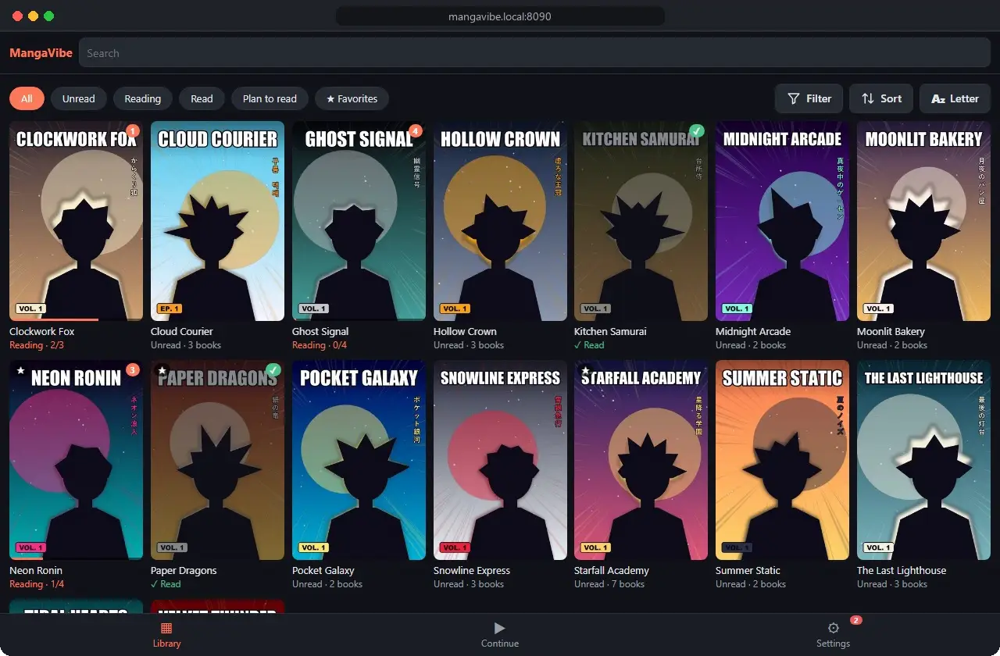
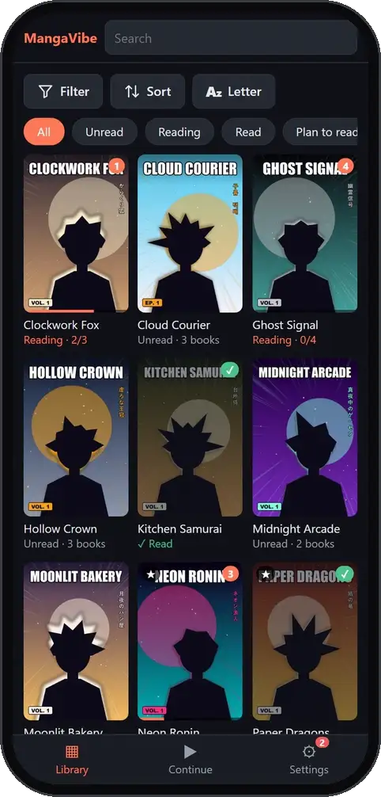

# MangaVibe

> [!WARNING]
> **This app is fully vibe coded.** Every line was written by an AI assistant (Claude), guided by
> conversation rather than written or reviewed line by line by a human developer. It has automated
> tests and has been checked in a browser, but it has not had a professional security audit.
> Use it at your own risk, keep it on your home network (see [Reading away from home](#reading-away-from-home)),
> and keep backups of anything you care about. Your manga folder is mounted read-only, so the app
> can't change your files.

<p align="center">
  
  &nbsp;
  
</p>
<p align="center"><sub>The series and art shown are made up for the demo.</sub></p>

## What is this?

MangaVibe is a self-hosted manga server that runs anywhere Docker does: a NAS, a home server or your PC.
Point it at your manga folder and it:

- **Finds and orders your books**, even with messy file names (`Vol 3`, `ch03v2`, `c10-18`, `15a`,
  Japanese titles, extras, duplicates).
- **Fetches covers and details** (titles, description, genres, authors, status) from AniList and
  MangaUpdates.
- **Gives you a fast reader in your phone's browser.** Right-to-left, left-to-right or webtoon,
  with swipe, tap zones, pinch zoom, and your progress saved on every page.

It reads `.cbz/.zip`, `.cbr/.rar`, `.cb7/.7z`, image `.epub`, `.pdf` and folders of images, without
unpacking them. Nothing is uploaded anywhere, and your files are never renamed or changed.

## Install

> [!CAUTION]
> **Never make MangaVibe reachable from the internet.** Don't forward port 8090 in your router, and
> don't put it behind a public address or reverse proxy. MangaVibe has **no login**: anyone who
> finds it can read, download and change everything in it. To read away from home, use a VPN
> instead. See [Reading away from home](#reading-away-from-home).

MangaVibe runs in **Docker**, a free app that runs programs in their own sealed box. You set it
up once, then MangaVibe updates itself. Open the steps for your system:

<details>
<summary><b>Windows</b></summary>

1. Install **[Docker Desktop](https://www.docker.com/products/docker-desktop/)** and restart the PC if
   it asks. Open Docker Desktop and wait until it says **Engine running** (you can skip signing in).
2. Open **PowerShell** (Start menu → type *PowerShell*). Paste this line, but first change `D:\Manga`
   to the folder your manga is in, then press Enter:

   ```powershell
   docker run -d --name mangavibe --restart unless-stopped -p 8090:8090 -v "D:\Manga:/manga:ro" -v "C:\MangaVibe:/data" ivokolarov/mangavibe:latest
   ```

   To get a folder's path, open it in File Explorer and click the address bar.
   `C:\MangaVibe` is where MangaVibe keeps its own data; it's created for you.
3. Open **http://localhost:8090** in your browser. The first scan starts by itself.

So it starts with the PC: Docker Desktop → **Settings** → **General** → turn on
**Start Docker Desktop when you sign in**.

</details>

<details>
<summary><b>Mac</b></summary>

1. Install **[Docker Desktop](https://www.docker.com/products/docker-desktop/)**. Pick
   **Apple Silicon** or **Intel** (Apple menu → **About This Mac** shows which one you have).
   Open it and wait until it says **Engine running** (you can skip signing in).
2. Open **Terminal** (Spotlight → type *Terminal*). Paste this and press Enter:

   ```bash
   docker run -d --name mangavibe --restart unless-stopped -p 8090:8090 -v "$HOME/Manga:/manga:ro" -v "$HOME/MangaVibe:/data" ivokolarov/mangavibe:latest
   ```

   This expects your manga in a folder called **Manga** in your home folder. If it's somewhere
   else, change `$HOME/Manga` to that path, e.g. `/Volumes/MyDrive/Manga`.
3. Open **http://localhost:8090** in your browser. The first scan starts by itself.

So it starts with the Mac: Docker Desktop → **Settings** → **General** → turn on
**Start Docker Desktop when you sign in**.

</details>

<details>
<summary><b>Linux</b></summary>

1. Install Docker (skip if you have it):

   ```bash
   curl -fsSL https://get.docker.com | sudo sh
   ```

2. Start MangaVibe. Change `$HOME/Manga` if your manga is somewhere else:

   ```bash
   sudo docker run -d --name mangavibe --restart unless-stopped -p 8090:8090 -v "$HOME/Manga:/manga:ro" -v "$HOME/mangavibe-data:/data" ivokolarov/mangavibe:latest
   ```

3. Open **http://localhost:8090**. It starts by itself after a reboot.

</details>

<details>
<summary><b>Synology NAS</b></summary>

Newer NAS (DSM 7.2+) use the **Container Manager** package; older ones use **Docker**. The steps
are the same; where a button has a different name, the older one is in brackets.

1. **Package Center** → install **Container Manager** (or **Docker**).
2. **File Station** → open the `docker` shared folder → create a folder named `mangavibe`.
3. Open **Container Manager** (**Docker**) → **Registry** → search `ivokolarov/mangavibe` →
   **Download** → tag `latest`. Wait until it shows up under **Image**.
4. **Image** → select `ivokolarov/mangavibe` → **Run** (**Launch**):
   - Container name `mangavibe`. Tick **Enable auto-restart** (on older DSM it's in
     **Advanced Settings**).
   - **Port Settings**: change the local port from *Auto* to `8090` (container port `8090`).
   - **Volume Settings** (**Volume**) → **Add Folder**: pick your manga folder, mount path
     `/manga`, tick **Read-only**.
   - **Add Folder** again: pick `docker/mangavibe`, mount path `/data`.
   - **Next** → **Done** (**Apply** → **Next** → **Done**).
5. Open **http://\<your NAS address\>:8090**, the same address you use for DSM but with `:8090`
   at the end (e.g. `http://192.168.1.20:8090`).

</details>

<details>
<summary><b>Other servers (Unraid, Portainer, Docker Compose, …)</b></summary>

The image is [`ivokolarov/mangavibe`](https://hub.docker.com/r/ivokolarov/mangavibe) (Intel and ARM).
Give it port **8090**, auto-restart, and two folders:

| In the container | What it is | Mode |
|---|---|---|
| `/manga` | your manga folder | **read-only** |
| `/data` | database, covers, cache, plugins (empty to start with) | read-write |

Docker Compose:

```yaml
services:
  mangavibe:
    image: ivokolarov/mangavibe:latest
    container_name: mangavibe
    ports:
      - "8090:8090"
    volumes:
      - /path/to/manga:/manga:ro
      - /path/to/mangavibe-data:/data
    restart: unless-stopped
```

Optional settings (environment variables):

| Variable | Default | What it does |
|---|---|---|
| `TZ` | `UTC` | Your time zone, e.g. `Europe/Sofia` |
| `LIBRARY_PATHS` | `/manga` | More than one library: `/manga,/manga2` (mount each one read-only) |
| `RESCAN_HOURS` | `6` | How often the library is scanned for new files |
| `CACHE_MAX_GB` | `2` | Space for resized pages and thumbnails |
| `PUID` / `PGID` | `1000` | User the app runs as, if that user can read your manga folder |
| `AUTO_UPDATE` | `1` | `0` turns off update checks |

</details>

### Open it on your phone

Your phone must be on the same Wi-Fi. Open **http://\<computer address\>:8090** in its browser, then
use **Add to Home Screen** so it opens full screen like an app. To find the computer's address:

- **Windows:** Settings → Network & internet → Wi-Fi (or Ethernet if you are on cable) → your network → **IPv4 address**
- **Mac:** System Settings → Wi-Fi → **Details** next to your network → TCP/IP → **IP address**
- **Synology:** the address you use for DSM

The computer has to be on (and Docker Desktop running) while you read. To read away from home, use
a VPN, never an open port: see [Reading away from home](#reading-away-from-home).

## Organizing your manga

Each folder directly inside your library is one series. Files inside it can be named almost
any way you like:

```
/manga
├── One Piece/
│   ├── One Piece v01.cbz
│   ├── One Piece v02.cbz
│   └── One Piece ch1050-1060.cbz
├── Berserk/
│   └── Berserk Vol.01/          ← a folder of images is one book
└── Solo Leveling/
    └── Solo Leveling c001.epub
```

If a file ends up in the wrong place, fix it on the series page → **Files** tab. You can set its
volume, chapter or a chapter range by hand, or mark it as an extra or hidden. Only MangaVibe's
database changes; the file itself does not.

## Using it

- **Library**: all your series with covers. Search titles, authors and alternative names; filter by
  genre, tag, reading status, format or favorites; sort by title, date added, last read, score and more.
- **Series page**: details and the list of books. Mark books read or unread (or everything before
  one), set a reading status, add favorites. If the details are wrong, **Fix match** lets you search
  AniList or MangaUpdates, or paste a link.
- **Reader**: tap or swipe to turn pages; tap the middle to show the controls (reading direction,
  fit, page slider, fullscreen). At the end of a book it offers the next one.
- **Continue**: everything you're in the middle of, so you can pick up where you left off.
- **Settings**: look and theme, reader defaults, library folders and **Rescan all**, metadata
  sources and updates. A number on the
  Settings icon means something **needs attention**: a series that couldn't be matched, a file that
  can't be read, duplicates or missing chapters.

## Updating

MangaVibe checks for a new version once a day and shows a message. Tap **Update now**, and it
installs the new version and restarts by itself. You don't have to touch Docker.

Once in a while, a version needs a new image, and the message tells you so. Your library,
progress and settings are kept, so this is safe:

- **Windows, Mac, Linux:** run these, then run the same `docker run` line from the install steps again
  (on Linux, put `sudo` in front of each):

  ```bash
  docker pull ivokolarov/mangavibe:latest
  docker rm -f mangavibe
  ```

- **Synology:** **Registry** → download `ivokolarov/mangavibe` `latest` again. Then **Container** →
  select `mangavibe` → stop it → **Action** → **Reset** (**Clear**), and start it again.
- **Docker Compose:** `docker compose pull && docker compose up -d`

If a new version doesn't start 3 times in a row, MangaVibe goes back to the previous one by itself.

## Reading away from home

> [!CAUTION]
> **Do not open port 8090 to the internet.** It's the easy way to read outside your home, and it's
> unsafe. MangaVibe is made for your home network only and has **no password or login**.

**What "opening the port" means.** You make MangaVibe reachable from anywhere through your home's
internet address. People usually do this by:

- adding a **port forwarding** rule for 8090 in their router
- putting the NAS or PC in the router's **DMZ**, or leaving **UPnP** on so apps open ports by themselves
- setting up a **reverse proxy** with a public address: Synology's *Login Portal → Reverse Proxy*,
  Nginx Proxy Manager, a Cloudflare tunnel without a login in front, or similar

**What happens if you do.** Bots scan the whole internet for open ports all the time, so it will be
found within days, even if you never share the address. Anyone who finds it can:

- read and download your whole library, and see what you've been reading
- change or wipe reading progress, statuses, titles, descriptions, posters and matches
- disconnect plugins or break them, for example the MyAnimeList sync
- slow down or overload your NAS or PC by starting scans over and over
- reach any bug in MangaVibe or the packages it uses, straight from the internet

Your manga files themselves stay safe, because they're mounted read-only. The login details plugins
save, such as MyAnimeList's, are never sent to the browser. **Everything else is open to anyone.**

**Do this instead: use a VPN.** A VPN lets your phone join your home network from anywhere, so
MangaVibe stays private:

1. **Tailscale** (free, easiest). Install it on the NAS or PC that runs MangaVibe (on a Synology:
   **Package Center → Tailscale**) and on your phone, and sign in to the same account on both. Then
   open `http://<the NAS or PC's Tailscale name or address>:8090` on your phone, from anywhere.
   Nothing on your router changes.
2. **Your NAS's or router's VPN server**, for example Synology's **VPN Server** package (WireGuard
   or OpenVPN) or the VPN built into many routers. Connect to it on your phone, then open the same
   address you use at home.

**Not sure if you opened it by accident?** Check your router's *Port forwarding* (or *Virtual
server*) list for 8090 and remove it, turn UPnP off if you don't need it, and remove any reverse
proxy rule that points at port 8090.

## Customizing

- **Look:** edit `custom.css` in your data folder (created on first start, with examples), then reload the page.
- **Plugins:** add features with plugins, see [Plugins](#plugins) below.

## Plugins

Plugins add features without changing the app, such as syncing with a tracker site. A plugin is
a single `.py` file.

### Available plugins

| Plugin | What it does |
|---|---|
| [MyAnimeList sync](https://github.com/ivokolarov0/manga-vibe-ext-mal-profile-sync) | Sends Reading / Completed to your MyAnimeList list as you read, and pulls them back with **Sync all**. Its README shows how to connect your account step by step. |
| [Manga Translate](https://github.com/ivokolarov0/manga-vibe-ext-translate) | Shows English over the speech bubbles of Japanese manga while you read. Small AI models on your own computer find, read and translate the text: free, private, nothing is sent online. Needs a computer with a graphics card on your network (or the same one). Its README walks through the setup step by step. |

### Install a plugin

1. Download the plugin's `.py` file (on GitHub: open the file → **Download raw file**).
2. Put it in the `plugins` folder of your data folder: `docker/mangavibe/plugins` on a Synology,
   or `plugins` inside the folder you mounted as `/data` (create it if it isn't there).
3. In MangaVibe: **Settings → Plugins → Reload plugins**. The plugin appears in the list. If it has
   settings, buttons or updates, its **Settings** button opens a page with them.

**Updating a plugin.** Plugins that publish releases on GitHub (like MyAnimeList sync) have an
**Updates** part on their page (**Settings → Plugins → Settings** next to the plugin). The list shows
*Update X* next to a plugin with a new version:

- MangaVibe checks once a day and shows *Version X is available*. **Check for updates** looks right away.
- Press **Update to X** to install it, or **Skip this version** if you don't want it. A skipped version
  isn't offered again, but a newer one is. **Show it again** brings it back.

Plugins never update by themselves. The new version is checked before it replaces the old one, and your plugin settings are kept. For
other plugins, replace the file and press **Reload plugins**.

To remove a plugin, delete its file. Switch a plugin off with its toggle in **Settings → Plugins**.

> [!WARNING]
> **Only install plugins you trust.** A plugin is code that runs inside MangaVibe with full access
> to its data, including the logins other plugins save. Install plugins from this list or ones whose
> code you've read.

### Write your own

See [docs/PLUGINS.md](docs/PLUGINS.md) for how plugins work, the events they can react to, and an
example in [examples/plugins](examples/plugins).

## Q&A

**Why another manga server?**
I tried the popular options and didn't like them. I wanted an easy way to get metadata, and it
turned out I had to run an extra Docker container and install a browser extension that needed
access to all domains (it didn't work when I limited it to specific ones). After all that,
identify still didn't work. So I said f*ck it, I'll vibe code my own: extensible, with metadata
and match % built in from the start. I didn't feel like making a mobile app, so the browser is enough.

**Why is the manga folder read-only?**
The code was written almost entirely with Claude, and it may have gaps. I don't want to be
responsible if something decides it should delete a file in your collection. So I explicitly
don't want the app to have any permission to touch your files.

**Why is there no user login?**
Too much of a headache, and it means handling sensitive information I don't want to be responsible
for. Also, someone will want Google/Apple login, then 2FA, then passkeys, then "forgot password",
which means a mailing service or an SMTP server... In short, tedious, and I don't feel like it.
At most there will be a PIN page or a simple password.

**Why only manga and not comics?**
I'm making it for myself, and I mostly read manga. That said, you can already read comics with it:
switch the reading direction to left-to-right, change the fit, and so on. If you want more
comic-specific features, there's a plugin system, so you can vibe code a plugin for them.

**Why is there no option to rename or optimize files?**
Again, I don't want the app to have access to your files. Rename and optimize them outside the
app; I don't want to be responsible if something important disappears.

**Do you accept feature requests and changes?**
Not sure. Small things like "this icon isn't centered" or "there's no hover here": no. This was
mainly meant as a personal project. If people like it and want to add features, pull requests are
welcome, but I work 9 to 6 every day, so I don't know how much time I'll have to review them. I'm
not saying no for now, but it may be easier to fork it and change it yourself without waiting for me.

**You're a developer and you vibe coded everything. Why?**
I enjoy having more free time. With my work hours and the "free" time I have, the whole project
would probably have taken me a few months. What you see here took 2–3 hours to vibe code a working
base version and another 6–10 hours to polish it and add features. If you're one of those people
who hate everything AI... this is not the right place. Go to the art section. ;)

**Why is there no executable file?**
Docker runs it anywhere, from a NAS to your desktop, packs everything it needs and keeps it away
from your files. Making installers for every OS sounds like a job, and I already
have one of those.

**If you don't plan to accept pull requests, why make it public?**
It makes updating easier, and if someone wants a quick and dirty solution, here you go.

## Troubleshooting

- **Logs:** `docker logs mangavibe`, or the container's log view in your Docker GUI.
- **"Cannot write to the data folder":** the user the app runs as can't write to the folder mounted
  as `/data`. Give it read and write access (e.g. `chown -R 1000:1000 /path/to/mangavibe-data`, or
  the folder's permission settings on a NAS), then restart the container.
- **Which user it runs as:** the container starts as root and switches to `PUID`:`PGID` if that user
  can read your manga folder; otherwise it stays root and logs why. Both are fine, because the manga
  folder is read-only either way. To use your own user, set `PUID`/`PGID` to its ids (`id -u`, `id -g`).
- **Adding another library folder:** mount it into the container (read-only), e.g. as `/manga2`, and
  restart. Then go to **Settings** → **Library folders** → **+ Add folder** and pick it. **Remove**
  takes it out of the library again; your files are not touched.
- **Going back to the code in the image:** stop the container, delete `code/current` in the data
  folder, start it again.

---

## For developers

[SPEC.md](SPEC.md) is the full plan and [DECISIONS.md](DECISIONS.md) explains the choices made.

### Run on your PC

```bash
python -m venv .venv
.venv/Scripts/python -m pip install -r requirements-dev.txt
.venv/Scripts/python dev.py
```

Then open http://localhost:8090. `dev.py` creates a small fake library in `dev-library/`.
To use real manga: set `LIBRARY_PATHS=D:\Manga` before running it.

Working in a git worktree? Run `python preview.py` from it instead: it borrows the main
checkout's `.venv` and `dev-library`, gives each worktree its own port and database, opens the
browser and prints a LAN address for testing on a phone. Several worktrees can run at once.

### Tests

```bash
.venv/Scripts/python -m pytest
```

### Docker image

- `python build.py` builds `mangavibe:latest` locally, `--run` starts it with `docker-compose.yml`,
  `--save` writes `mangavibe.tar` (import it elsewhere with `docker load -i mangavibe.tar`).
- Releases: publish a GitHub release from `main`, e.g. `gh release create v1.4.0 --generate-notes`.
  GitHub Actions publishes the image to Docker Hub and ghcr.io (`.github/workflows/image.yml`), and
  running apps pick up the new code through auto-update. A pre-release (`--prerelease`) gets an
  image but is not offered to running apps. The old `releases` branch is no longer used.

### Layout

```
app/main.py             startup, routes
app/config.py           environment variables
app/models.py, db.py    SQLite tables, first start, migrations
app/scanner/            parser.py (file names), archives.py (reading), walker.py (scanning)
app/api/                series.py, books.py, system.py
app/plugins/            plugin system
app/updater.py          auto-update from the newest GitHub release
app/images.py           thumbnails, resized page cache
app/web/index.html      the page: Alpine templates for every view
app/web/static/css/     styles: main.css imports one file per feature (CSS layers)
app/web/static/js/      app.js (Alpine data), reader.js (plain-JS reader), common.js,
                        vendor/alpine.min.js
app/web/static/icons/   app icons; manifest.json next to them
examples/plugins/       example plugin
docker/entrypoint.sh    container start script
```
