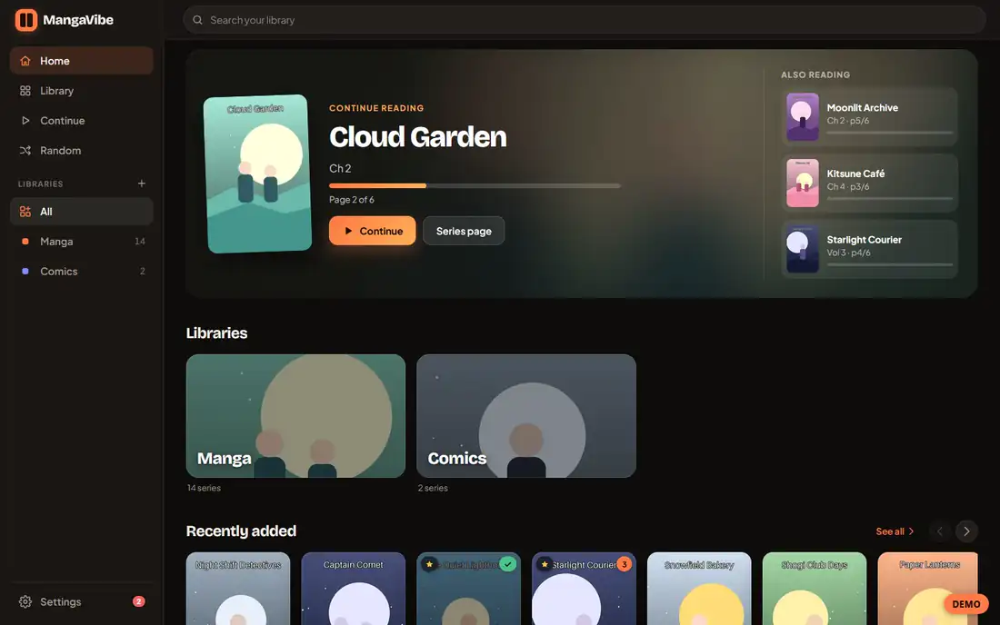
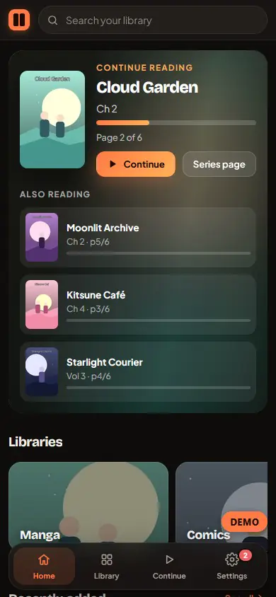
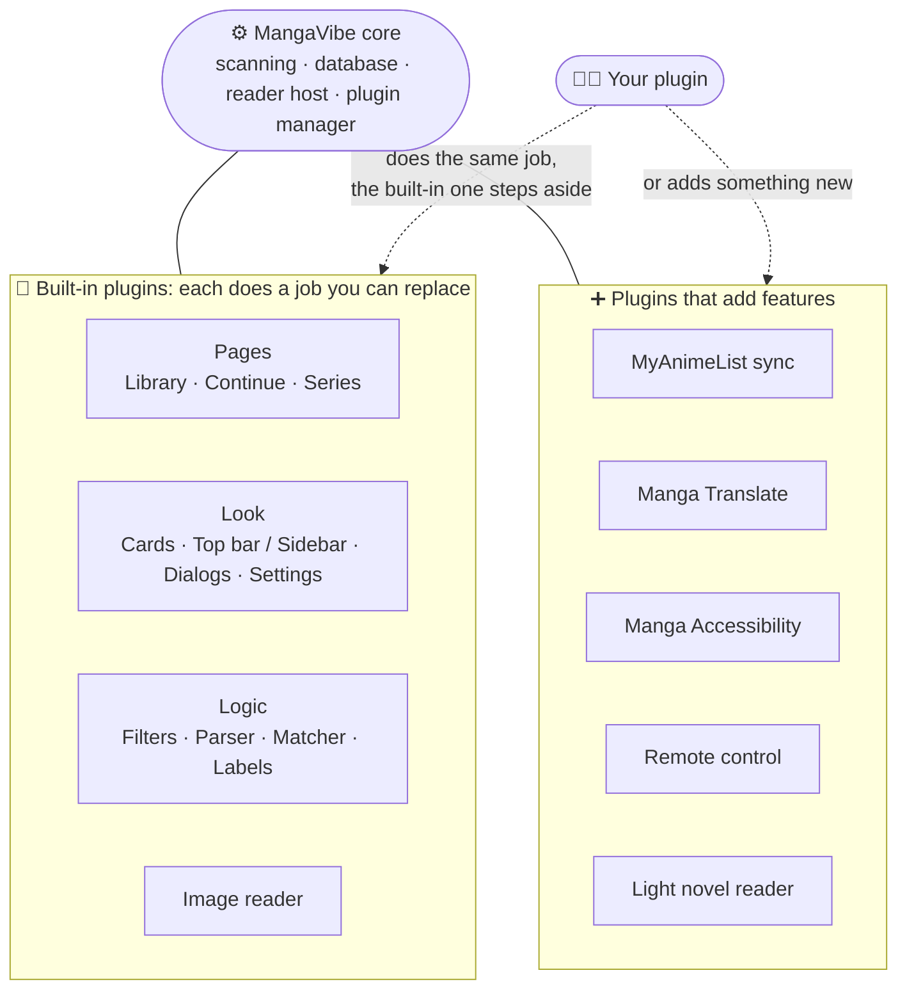
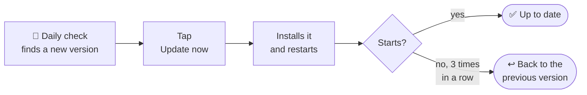

<h1 align="center">📖 MangaVibe</h1>

<p align="center">
  <b>Your manga, on your own server, read anywhere at home.</b><br>
  <sub>Self-hosted · runs in Docker · built to be changed with plugins</sub>
</p>

<p align="center">
  <a href="https://github.com/ivokolarov0/manga-vibe/releases/latest"></a>
  <a href="LICENSE"></a>
  <a href="https://github.com/ivokolarov0/manga-vibe/actions/workflows/image.yml"></a>
  <a href="https://github.com/ivokolarov0/manga-vibe/actions/workflows/android.yml"></a>
  
  <a href="https://ivokolarov0.github.io/manga-vibe/plugins/"></a>
  <a href="https://ivokolarov0.github.io/manga-vibe/plugins/"></a>
  
</p>

<p align="center">
  <a href="https://ivokolarov0.github.io/manga-vibe/"><b>▶ Try the demo</b></a> ·
  <a href="https://ivokolarov0.github.io/manga-vibe/docs/"><b>📚 Docs</b></a> ·
  <a href="https://ivokolarov0.github.io/manga-vibe/plugins/"><b>🧩 Plugin reference</b></a> ·
  <a href="#-install">Install</a> ·
  <a href="#-features">Features</a> ·
  <a href="#-make-it-yours-plugins">Plugins</a> ·
  <a href="#-organizing-your-manga">Organizing</a> ·
  <a href="#-updating">Updating</a> ·
  <a href="#-more">More</a>
</p>

<p align="center">
  
  &nbsp;
  
</p>
<p align="center"><sub>The series and art shown are made up for the demo.</sub></p>

Point MangaVibe at your manga folder and read on your phone, tablet or computer. It runs anywhere
Docker does: a NAS, a home server or your PC. Nothing is uploaded anywhere, and your files are never
renamed or changed unless you ask.

**[▶ Try the demo](https://ivokolarov0.github.io/manga-vibe/)** in your browser: the real
interface on a made-up library. Browse, read, switch plugins; nothing is saved. It's a presentation,
not a real install: there's no server behind it, and some of what it does is only acted out for the
demo, so it can behave a little differently from MangaVibe on your own server.

> [!TIP]
> **Built to be changed.** Most of MangaVibe is plugins: the pages, the cards, the filters, the
> reader, the file name parser and more. Don't like one? Switch on another plugin, or write your own,
> and replace just that part. See [Make it yours](#-make-it-yours-plugins).

> [!WARNING]
> **This app is fully vibe coded.** Every line was written by an AI assistant (Claude), guided by
> conversation rather than written or reviewed line by line by a human developer. It has automated
> tests and has been checked in a browser, but it has not had a professional security audit.
> Use it at your own risk, keep it on your home network, and keep backups of anything you care about.
>
> <details><summary>What can change my files?</summary>
>
> Only two things, both when you ask: **Delete series** removes a series' folder, and the
> **Optimize** plugin (off until you switch it on) replaces books with smaller versions. Mount the
> manga folder read-only (`:ro`) if you never want either.
> </details>

---

## 🚀 Install

> [!CAUTION]
> **Never make MangaVibe reachable from the internet.** Its login is off unless you switch on
> Accounts, and even then it isn't built to face the internet. To read away from home, use a VPN:
> see [Reading away from home](docs/away-from-home.md).

MangaVibe runs in **Docker**. You set it up once (about 10 minutes); after that it updates itself.

| Your system | How |
|---|---|
| 🪟 **[Windows](docs/install/windows.md)** | Docker Desktop and one command in PowerShell |
| 🍎 **[Mac](docs/install/mac.md)** | Docker Desktop and one command in Terminal |
| 🐧 **[Linux](docs/install/linux.md)** | Docker and one command |
| 🗄️ **[Synology NAS](docs/install/synology.md)** | Container Manager, step by step with clicks |
| 🐳 **[Other servers](docs/install/docker.md)** | Unraid, Portainer, Docker Compose, environment variables |

📱 Then read on your phone: **[Phone and Android app](docs/phone.md)**.

---

## ✨ Features

| | |
|---|---|
| 📚 **Your library, sorted out** | Folders become series, books in the right order even with messy names, covers and details found for you |
| 🔍 **Finding something to read** | Search, filters, saved searches and Continue reading |
| 📱 **A reader made for phones** | Pages or vertical, swipes and taps, zoom, progress saved on every page |
| 👁️ **Easy on the eyes** | Page brightness and colours, read aloud, screen readers |
| 🧰 **Looking after your collection** | Needs attention lists, fixing a book's place by hand |
| 🎨 **Your way** | Themes, an Android app, smaller books, remote control, your own CSS |
| 🧩 **Plugins all the way down** | Add features, or replace any part of the app you don't like |

Tap a section for the details.

<details>
<summary><b>📚 Your library, sorted out</b></summary>

- **Each folder is a series**, and the books in it are put in order even with messy file names:
  `Vol 3`, `ch03v2`, `c10-18`, `15a`, Japanese titles and duplicates. Extras
  aren't guessed from names; mark them yourself.
- **Reads** `.cbz/.zip`, `.cbr/.rar`, `.cb7/.7z`, image `.epub`, `.pdf` and folders of images, without
  unpacking them. Pages can be JPEG, PNG, WebP, GIF, AVIF, JPEG XL, BMP or TIFF. Archives inside
  archives and files with the wrong extension work too. **Light novels** (text `.epub`) are found
  too, and read with the [Light novel reader](https://github.com/ivokolarov0/manga-vibe-light-novel)
  plugin.
- **Several library folders**, each scanned every few hours and on start. New files show up by
  themselves; a removed file disappears.
- **Separate libraries**, e.g. Manga and Comics, as tabs on the home screen. A whole folder goes in
  one, and a single series can be moved to another without moving its files. Each library has its own
  reading mode, and an optional password that hides it until it's unlocked.
- **Accounts** (optional, Settings → Plugins): everyone logs in and has their own progress, favorites,
  Continue reading, saved searches and reader settings. Admins manage the app and pick which libraries
  each account sees (e.g. the kids only get Comics).
- **Covers and details** (titles in three languages, description, genres, tags, authors, status,
  score, links) from **AniList** and **MangaUpdates**, matched automatically with a match score.
  If it picked the wrong series, **Fix match** lets you search or paste a link.
- **Edit anything by hand**, upload your own poster, and your edits are kept when the details are
  refreshed.

</details>

<details>
<summary><b>🔍 Finding something to read</b></summary>

- **Search** titles, alternative names and authors.
- **Filter** by genre and tag (include or exclude), reading status, format, favorites, first
  letter, length (e.g. under 10 volumes, at least 100 chapters), and complete or incomplete
  collections (finished series with volumes missing); **sort** by title, date added, last updated,
  last read, score, year or unread count.
- **Save a search** (e.g. only Isekai) and pick it again from the Saved button, in any library.
- **Continue**: everything you're in the middle of, to pick up where you left off.
- **If you liked this**: AniList's recommendations at the end of a series page, with covers; the ones
  you already have open here (a built-in plugin you can switch off).
- **Reading status** worked out from your progress (reading, completed, …), or set by hand, plus
  favorites. Mark a book read or unread, or everything before it.

</details>

<details>
<summary><b>📱 A reader made for phones</b></summary>

- **Pages or vertical** (webtoons). Pages turn like every digital reader: the next one is on the
  right (→, a tap on the right, a swipe to the left). Set per series or per library.
- **Swipe or tap** to turn pages (or the volume buttons, in the Android app). Tap zones can be
  one-handed, and the buttons move to your reading hand; pinch and double-tap to zoom, with a lock
  to keep the page fitted.
- **Fit** to screen, width or height, or original size. Pages are resized for your screen and the
  next ones preloaded, so turning is instant.
- **Progress saved on every page**, and the next book offered at the end.
- **On a computer:** the wheel scrolls a tall page and turns the page at its end; click the sides
  or use the arrow keys, Page Up/Down and Space; Ctrl + wheel zooms and F goes fullscreen. Move the
  mouse to bring up the controls.

</details>

<details>
<summary><b>👁️ Easy on the eyes, and for readers who can't see the page</b></summary>

- **Page look:** brightness, contrast, and inverted (white lines on black) or warm colours.
- **Read aloud:** with a plugin that has text for the page (like Manga Accessibility or Manga
  Translate), MangaVibe reads it with your device's voice. Pick the speed and voice, and let it turn
  the pages by itself to listen to a whole chapter.
- **Screen readers** (TalkBack, NVDA, VoiceOver) get the same text.

</details>

<details>
<summary><b>🧰 Looking after your collection</b></summary>

- **Needs attention** in Settings lists what to fix: series that couldn't be matched, series
  matched to the same entry, files that can't be read (with what's inside them), duplicates side
  by side, and missing chapters.
- **Fix a book's place by hand** (Files tab): its volume, chapter, a chapter range, or mark it as an
  extra or hidden. Only MangaVibe's database changes, never the file.

</details>

<details>
<summary><b>🎨 Your way</b></summary>

- **Dark or light theme**, card size, endless scrolling or numbered pages, and the title language.
- **An Android app**: fullscreen, the screen kept on, volume buttons and the phone's voice. See
  [Phone and Android app](docs/phone.md).
- **Make books smaller** (Optimize, in Settings → Plugins): converts PNG and JPEG pages to JPEG XL (or
  AVIF, WebP), for one series or all of them. Often half the size or less. It replaces your files.
- **Remote control** (MCP, a plugin): an assistant like Claude can search, read, turn pages, change
  settings and press any button for you, and say what is on the screen. The base for voice control.
  See [manga-vibe-mcp](https://github.com/ivokolarov0/manga-vibe-mcp).
- **Your own styles** in `custom.css` in the data folder (created on first start, with examples).
- **Updates itself** (see [Updating](#-updating)).

</details>

---

## 🧩 Make it yours: plugins

MangaVibe is made to be customized as far as it can go, and plugins are how. The app is a small
core, and almost everything around it is a plugin you can switch, swap or write yourself:



| | What it means |
|---|---|
| ➕ **Add features** | Tracker sync, translation over the speech bubbles, descriptions read aloud for blind readers, official chapter counts, remote control, a reader for light novels. One button in **Settings → Plugins → Get plugins**. |
| 🔁 **Replace parts of the app** | Each part (a page, the cards, the filters, the reader, the parser…) is a *job* done by a built-in plugin. Switch on another plugin for that job and the built-in one steps aside. If yours fails, the built-in one takes over, so the app never breaks. |
| 🟰 **Same rules for everyone** | The built-in plugins use only the public plugin API, so a plugin you write can do anything they do. |
| 🧑‍💻 **Write your own** | Python, with HTML, CSS and JavaScript for the page. Vibe coding one with an AI assistant works well. Start with the **[plugin reference](https://ivokolarov0.github.io/manga-vibe/plugins/)**: every part of a plugin, each with a minimal sample. |

> [!TIP]
> **Writing a plugin? Start with the [plugin reference](https://ivokolarov0.github.io/manga-vibe/plugins/)**:
> every part of a plugin, each described in a few lines with a minimal code sample. Read the text, the
> code, or both ([also on GitHub](docs/PLUGIN-REFERENCE.md)).

> [!IMPORTANT]
> **Free, all of it.** No part of MangaVibe may need a payment, and no paid plugins are allowed: no
> subscriptions, no paywalled features, no paid service that works through it. Money brings
> responsibilities: I'd have to keep the app compatible with paid plugins and stop making big changes
> so they don't break for paying customers, and I don't want that. This is a personal project, made
> for myself to see how much can be done with AI as hands-free as possible.
> [Why, in full](docs/qa.md#no-payments-no-paid-plugins).

👉 [Plugins](docs/using-plugins.md) to install, swap and update them · [The full guide](docs/PLUGINS.md) for every detail and job contract

---

## 📁 Organizing your manga

Each folder directly inside your library is one series. Files inside it can be named almost any way
you like:

```
/manga
├── One Piece/
│   ├── One Piece v01.cbz
│   ├── One Piece v02.cbz
│   └── One Piece ch1050-1060.cbz
├── Berserk/
│   └── Berserk Vol.01/          ← a folder of images is one book
└── Solo Leveling/
    └── Solo Leveling c001.epub
```

---

## 🔄 Updating

MangaVibe updates itself, and goes back by itself when a new version won't start:



| If… | Then |
|---|---|
| A new version is out | A message shows once a day. Tap **Update now**; you don't have to touch Docker. |
| It starts but has a problem | **Settings → Updates → Go back to an earlier version** and pick one. The version you left isn't offered again until a newer one is out. |
| The newer version changed the database | MangaVibe asks first: put back the copy of the database it made before that update (changes since then are lost), or keep the newer one. |
| A version needs a new Docker image | The message tells you so. Your library, progress and settings are kept. Steps: [Windows](docs/install/windows.md#when-a-version-needs-a-new-image) · [Mac](docs/install/mac.md#when-a-version-needs-a-new-image) · [Linux](docs/install/linux.md#when-a-version-needs-a-new-image) · [Synology](docs/install/synology.md#when-a-version-needs-a-new-image) · [Docker Compose and others](docs/install/docker.md#when-a-version-needs-a-new-image) |

---

## 📚 More

The **[website](https://ivokolarov0.github.io/manga-vibe/docs/)** has the install guides, the phone
app and help on one page, and a section for developers.

| | |
|---|---|
| 🌍 **[Reading away from home](docs/away-from-home.md)** | Why not to open a port, and how to use a VPN instead |
| 🧩 **[Plugins](docs/using-plugins.md)** | The available plugins, installing, updating and removing them, and replacing a part of the app |
| 🛠️ **[Troubleshooting](docs/troubleshooting.md)** | Logs, permissions, more library folders |
| ❓ **[Q&A](docs/qa.md)** | Why it's built the way it is, and the requests that are declined |
| 👩‍💻 **[For developers](docs/developers.md)** | Running it from source, tests, releases, the code layout, and writing a plugin: the [reference](https://ivokolarov0.github.io/manga-vibe/plugins/) and [the full guide](docs/PLUGINS.md) |

---

## ⚖️ Legal

MangaVibe is a reader for manga **you own**, on your own server. It doesn't include, download or
share any manga: it only shows the files you put in your library, to you. Covers and details come
from AniList and MangaUpdates, the way any tracker app shows them.

- Don't use it to share or publish manga or translated pages.
- Please support the creators: buy the manga you read.

Plugins are made by others and run their own code; [Plugins](docs/using-plugins.md) says what to
watch for. This project is provided as is, without any warranty.

**Licence:** [AGPL-3.0](LICENSE). In short: you may use, change and share MangaVibe; if you share a
changed version, or run one for other people, you must share its source code under the same licence.
