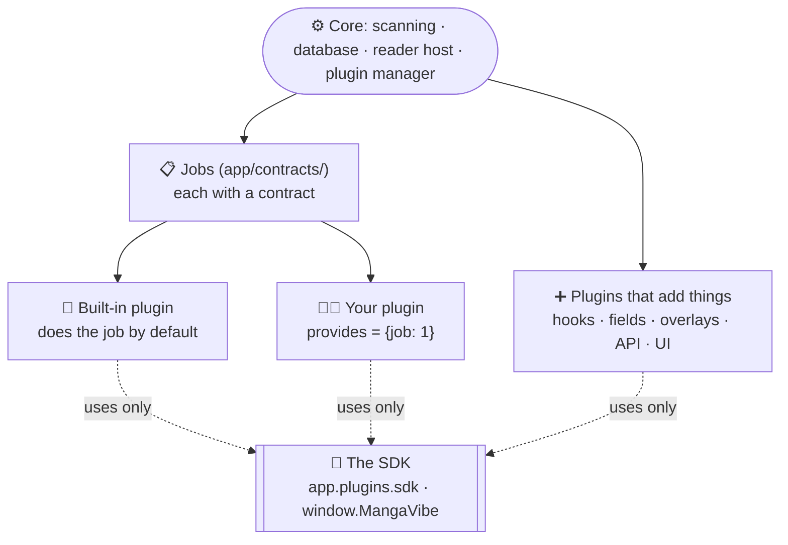
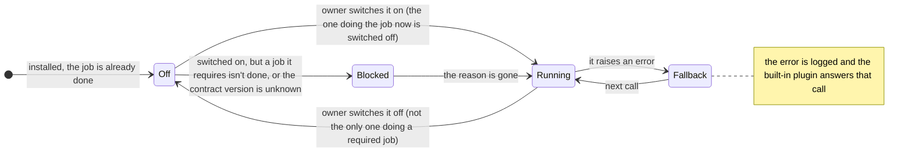

<h1 align="center">🧑‍💻 Writing MangaVibe plugins</h1>

<p align="center">
  <a href="../README.md">← README</a> ·
  <a href="using-plugins.md">Using plugins</a> ·
  <a href="https://ivokolarov0.github.io/manga-vibe/plugins/"><b>Plugin reference</b></a> ·
  <a href="#minimal-plugin">Minimal plugin</a> ·
  <a href="#what-a-plugin-can-do">What a plugin can do</a> ·
  <a href="#jobs-replacing-a-part-of-the-app">Jobs</a> ·
  <a href="#the-sdk">The SDK</a>
</p>

> [!TIP]
> **New to plugins? Start with the [plugin reference](https://ivokolarov0.github.io/manga-vibe/plugins/)**
> ([also on GitHub](PLUGIN-REFERENCE.md)): every part of a plugin, each described in a few lines with a
> minimal code sample. This page is the full guide: the long explanations and every job's contract.

<details>
<summary><b>📑 Contents</b></summary>

| Start here | Add to the app | Replace a part |
|---|---|---|
| [Minimal plugin](#minimal-plugin) | [Drawing on pages](#drawing-on-pages) | [Jobs](#jobs-replacing-a-part-of-the-app) |
| [What a plugin can do](#what-a-plugin-can-do) | [Dropdowns](#dropdowns) | [Library filters](#the-library-query-job) |
| [Categories](#categories) | [Your own API and UI](#your-own-api-and-ui) | [Replacing a view](#replacing-a-view) |
| [The `ctx` object](#the-ctx-object) | [Assistants and voice control](#assistants-and-voice-control) | [Needs attention lists](#the-attentionlist-job) |
| [Reading events](#reading-events) | [A reader of its own](#a-reader-of-its-own) | [Saved searches](#the-saved-searches-job) |
| [Updates](#updates) | [Styling](#styling-plugins-and-your-own-customcss) | [Parser, matcher, labels](#server-jobs-the-parser-the-matcher-and-book-labels) |
| [Publish in a source](#publish-your-plugins-in-a-source) | [Example](#example) | [Image reader](#the-readerimages-job) |
| [The SDK](#the-sdk) | [The activity log](#the-activity-log) | |

</details>

**MangaVibe is built so that people can change it with plugins, as far as that can go.** The app is a
small core (scanning, the database, the reader host, the plugin manager) and plugins that together
make the app: the pages, the cards, the top bar, the dialogs, Settings' sections, the filters, the
image reader, the file name parser, the metadata matcher, book labels, even accounts and libraries.



So a plugin can do two things:

- **Add** something: a field, a button, a page overlay, a tracker sync, a reader for another kind of book.
- **Replace** a part the owner doesn't like: provide the same [job](#jobs-replacing-a-part-of-the-app)
  as a built-in plugin, and the owner switches yours on instead of it.

The built-in plugins are held to the same rules as yours: they use only [the SDK](#the-sdk) (a test
checks it), so whatever they do, your plugin can do too, and each one is a working starting point to
copy. If something can't be done with a plugin yet, that's a gap in the plugin API, not the intended
design.

A plugin is a Python file (or a folder with `__init__.py`) in the `plugins` folder inside
your data folder (`docker/mangavibe/plugins` on the NAS). After copying it there, press
**Settings → Plugins → Sources & setup → Reload plugins** (or restart the container). Each plugin can
be switched off in Settings → Plugins, except the only one doing a required job (it's marked
**Required**: it can only be replaced).

A plugin that fails to load, or crashes in a hook, is logged and skipped. It never stops the app.

**Plugins don't write to the manga folder.** Everything a plugin produces goes into MangaVibe's
database. Only two things in the app change the owner's files, and only when the owner asks:
**Delete series** (plugins hear about it through `on_series_deleted`) and the built-in **Optimize**
plugin, which replaces books with smaller ones. Optimize keeps the book's row, so a plugin's data
for the book and its pages stays (the pages are the same pages, in the same order).

## Minimal plugin

```python
from app.plugins import Plugin

class Hello(Plugin):
    id = "hello"            # unique
    name = "Hello"
    version = "1.0"
    description = "Logs every new book."
    category = "library"    # where Settings → Plugins lists it (see Categories)

    def on_book_scanned(self, ctx, book, parsed):
        ctx.log.info("New book: %s", book.file_name)
```

## What a plugin can do

| Feature | How |
|---|---|
| **Extra fields** shown on the series page | `fields = [FieldDef("key", "Label")]`, then `ctx.set_field(series, "key", value)` (any JSON value; `None` removes it) |
| **Fix ordering / parsing** | `on_book_scanned(ctx, book, parsed)`: change `parsed.volume`, `.chapter`, `.chapter_end`, `.extra`, `.extra_index`, `.version` |
| **Do something after a series scan** | `on_series_scanned(ctx, series, books)` |
| **Clean up when the owner deletes a series** | `on_series_deleted(ctx, series)`: called just before the series and its folder are deleted, so it and your data for it can still be read. Plugin API 6 |
| **Buttons on the series page** | `actions = [Action("key", "Label", confirm=None)]` and `run_action(ctx, key, series)` returning a message |
| **Dropdowns on the series page** | `choices = [Choice("key", "Label", options=[("value", "Label"), ...])]`, `get_choice(ctx, key, series)` and `set_choice(ctx, key, series, value)` (see [Dropdowns](#dropdowns)) |
| **Change how the app looks** | `css = """ :root { --accent: #ff6fa8; } """` (loaded after the built-in styles, so it wins) |
| **Metadata provider** | `is_provider = True`, implement `search(ctx, query, year)` → `list[Candidate]` and `fetch(ctx, provider_id)` → dict of series fields. Optional `url = "https://..."` links the site on the Metadata settings page |
| **React to reading** | `on_book_started(ctx, book, series)`, `on_book_completed(ctx, book, series)`, `on_series_status_changed(ctx, series, old, new)` (see [Reading events](#reading-events)) |
| **Tell the admin what happened** (the activity log) | `activity.log("myplugin.did", "what", target=("series", id), details={...})`; `on_activity(ctx, entry)` hears every entry (see [The activity log](#the-activity-log)). Plugin API 29 |
| **Settings boxes** on the plugin's page (Settings → Plugins → the plugin) | `settings_fields = [SettingDef("client_id", "Client ID", help="...", secret=False)]`; the value is in `ctx.settings["client_id"]`. `secret=True` values are never sent back to the browser. With `options=[("auto", "Automatic"), ("manual", "Manual")]` and `default="auto"` it's a dropdown instead; `ctx.setting("key")` gives the saved value or the default |
| **Buttons on the plugin's page** (Settings → Plugins → the plugin) | `global_actions = [Action("sync", "Sync all")]` and `run_global_action(ctx, key)` returning a message |
| **Status line** under the plugin in Settings | `status(ctx)` returning a short text, e.g. `"Connected as Ivo"` |
| **Open a page** (e.g. a login) from a button | return `OpenUrl(url, message="")` from `run_action` or `run_global_action` |
| **A web address of its own** (e.g. an OAuth callback) | `handle_web(ctx, path, params)` answers `GET /api/plugins/<id>/web/<path>`. Return a message (shown on a small page with a link back) or `OpenUrl(url)` to redirect; `None` = 404 |
| **Updates** from its GitHub releases | `repo = "owner/name"` (see [Updates](#updates)) |
| **Say what it uses** | `permissions = ["Connects to api.myanimelist.net"]`: shown in Settings; an update that adds one asks first (see [Updates](#updates)) |
| **Draw over reader pages** (e.g. a translation) | `overlay_label = "Translation"` and `page_overlay(ctx, book, page)` returning `Overlay(boxes=[Box(...)])` (see [Drawing on pages](#drawing-on-pages)) |
| **Have a page read aloud** (e.g. a description for blind readers) | `Overlay(speech="...")` from `page_overlay` (see [Drawing on pages](#drawing-on-pages)) |
| **Save something per page** | `ctx.set_page_data(book, page, value)`, `ctx.get_page_data(book, page)`, `ctx.page_data(book)` |
| **Keep something per series** for the plugin itself (e.g. notes on the characters) | `ctx.set_series_data(series, key, value)`, `ctx.get_series_data(series, key)`; never shown in the app |
| **Labels on books** in the series list | `book_badges(ctx, books)` returning `{book_id: "Translated"}` |
| **Buttons for the open book** (in the plugin's panel in the reader's options) | `book_actions = [Action("all", "Translate this chapter")]` and `run_book_action(ctx, key, book)` |
| **A tool of its own on the page being read** (e.g. an editor for its boxes) | a `book_actions` button that the plugin's `js` handles: `MangaVibe.on(id, "book-action", fn)`, `MangaVibe.reader.where()` and `.redraw()` (see [Drawing on pages](#drawing-on-pages)). Plugin API 12 |
| **Work for hours** without holding up other plugins | `ctx.run_in_thread(fn)`; the loop returns when `ctx.should_stop()` |
| **An API of its own** | `router = APIRouter()` (FastAPI), served at `/api/plugins/<id>/api/...` (see [Your own API and UI](#your-own-api-and-ui)). Plugin API 7 |
| **Its own buttons, sheets and scripts in the app** | `html = {"library-tools": "<button>…</button>"}` and `js = "…"` (see [Your own API and UI](#your-own-api-and-ui)). Plugin API 7 |
| **Decide what the lists show** (e.g. libraries, accounts) | `series_filter(ctx, request)`, `middleware`, `reading_mode()`, `series_info()`, `on_start()`, `can_switch_off()` (see [Your own API and UI](#your-own-api-and-ui)). Plugin API 8 |
| **Know who is asking** (accounts) | `users.current()`, `users.manage`, `users.personal_key()`, `enabled_by_default` (see [Your own API and UI](#your-own-api-and-ui)). Plugin API 9 |
| **Be listed under the right category** in Settings → Plugins | `category = "reader"`, or several: `category = ["reader", "library"]` (see [Categories](#categories)). Plugin API 10 |
| **Tools for assistants and voice control** (MCP) | `mcp_tools = [McpTool(...)]` and `run_mcp_tool(ctx, name, args)` on the server, `MangaVibe.screenCommand()` in the page (see [Assistants and voice control](#assistants-and-voice-control)). Plugin API 13 |
| **A reader of its own** for books the page reader can't show (light novels) | `reads = ["epub-text"]`, `ctx.text_sections(book)` on the server, `MangaVibe.registerReader()` in the page (see [A reader of its own](#a-reader-of-its-own)). Plugin API 14 |
| **Do a part of the app, replacing the built-in one** (e.g. the filters, a page) | `provides = {"<job>": 1}`, and `requires` for what it needs another plugin to do (see [Jobs](#jobs-replacing-a-part-of-the-app)). Plugin API 15 |
| **Speak the reader's language** | `t("…")` in markup, `MangaVibe.t()` in scripts, `N_()` / `t()` from `app.plugins.sdk` in Python, and `i18n/<lang>.po` files next to its `__init__.py` (see [Translations](#translations)). Plugin API 27 |

## Translations

Plugin API 27 (issue #263). The app is shown in each person's language (Settings → Display → Language;
by default the browser's), from gettext `.po` files: `app/web/i18n/<lang>.po`, one per language, with
`app/web/i18n/messages.pot` as the template. The English text is the key (`msgid`), so a text that has no
translation is simply shown in English.

- **In markup** (your `html`, your view templates): `t('Sync now')` and `tn('{n} chapter', '{n} chapters', n)`
  work in Alpine expressions, e.g. `<button x-text="t('Sync now')">`. A sentence with markup in it:
  `x-html="th('Only {name} is shown', { name: '<b>' + esc(name) + '</b>' })"` (the text is escaped, the values
  go in as HTML). In a view template (Jinja) use `{{ t("Sync now") }}`: it's drawn in the page's language on
  the server; `{{ t("Path of {path}", path='<code>…</code>'|safe) }}` puts markup into a sentence.
- **In your `js`**: `MangaVibe.t(text, values)`, `MangaVibe.tn(singular, plural, n, values)`, `MangaVibe.th`, `MangaVibe.lang`
  (e.g. `"bg"`), and `MangaVibe.fmtDate`, `fmtDateTime`, `fmtTime`, `fmtNum`, which write dates and numbers
  the language's way (`Intl`).
- **In Python**: `from app.plugins.sdk import N_, t, tn`. Every request runs in the language of the person
  asking, so `t()` works in your API, `status()`, `run_action()` messages and `HTTPException(400, t("…"))`.
  Mark a label that's defined once and shown later with `N_("Sync")` (e.g. a `settings_pages` label).
  Your plugin's `name`, `description`, `permissions`, and the labels of its `settings_fields`, `actions`,
  `fields` and `choices` are translated by the app where it shows them: put them in your `.po` and they
  show in the person's language. Background work (scans, events) runs in English.
- **Placeholders** are `{name}`: `t("Synced {count} series", { count })` (Python: `t("…", count=3)`). `tn()`
  gives `{n}`. Give `t()` the English text as a plain string, not a variable: the texts are found in the code.
- **Your own translations**: a folder plugin ships `i18n/<lang>.po` next to its `__init__.py`, the same
  format as the app's (`msgid` = your English text, `msgstr` = the translation, and a `Plural-Forms` header
  for `tn()`). They're used while your plugin is on, for texts the app's own files don't translate (the
  app's own words can't be changed). Start one by copying a language's header from `app/web/i18n/`.

## Categories

Settings → Plugins groups plugins by category, so the owner can find them and see what each one
changes. Set `category` to one of these:

| Category | For plugins that | Examples |
|---|---|---|
| `metadata` | find titles, descriptions, covers (`is_provider = True`) | AniList, MangaUpdates |
| `reader` | change the reader: page overlays, `book_actions`, page tools | `examples/plugins/page_info.py`, Manga Translate |
| `library` | change lists, series pages and books: fields, actions, libraries, searches | Libraries, Saved searches, Optimize, `translation_groups.py` |
| `system` | handle users, access, middleware, maintenance | Accounts |
| `appearance` | only change how the app looks (`css`) | `examples/plugins/sakura_theme.py` |
| `other` | don't fit any of the above | |

A plugin that spans areas lists several: `category = ["reader", "library"]`. It's listed under the
first one and tagged with the others. Unknown names are left out (and logged).

**Left empty**, the category is worked out from what the plugin uses: `is_provider` → `metadata`,
`overlay_label` or `book_actions` → `reader`, only `css` (nothing else, no hooks) → `appearance`,
anything else → `other`. So older plugins are grouped without changes, but setting it is clearer.

`GET /api/plugins` sends each plugin's `category` (the main one), `categories` (all of them, main
first) and `builtin` (true for the plugins in `app/plugins/builtin/`, false for the ones the owner
installed), plus `categories` at the top: every category key with its label, in the order shown.

## The `ctx` object

| | |
|---|---|
| `ctx.log` | logger (messages appear in the container log) |
| `ctx.settings` / `ctx.save_settings(dict)` | the plugin's own saved settings |
| `ctx.setting(key)` | one setting: the saved value, or the `SettingDef`'s `default` while nothing is saved |
| `ctx.set_field(series, key, value)` / `ctx.get_field(series, key)` | extra fields |
| `ctx.list_pages(book)` | page names inside a book |
| `ctx.list_entries(book)` | all names inside a zip/cbz (not only images) |
| `ctx.read_entry(book, name)` | bytes of one entry, e.g. `"ComicInfo.xml"` |
| `ctx.read_series_file(series, name)` | bytes of a sidecar file in the series folder (e.g. `series.json`), or `None` |
| `ctx.db` | the database session (advanced; MangaVibe commits after hooks) |
| `ctx.reading_direction(series)` | `paged` or `vertical` (webtoons): the way the reader shows the series. Paged always turns forward to the right (there is no right to left). Set on the series, else a plugin's default (e.g. its library's, Settings → Libraries), else Settings → Reader. Plugin API 5 |
| `ctx.reading_status(series)` | the status the app shows: `unread`, `reading`, `completed`, `plan_to_read`, `on_hold`, `dropped` |
| `ctx.set_reading_status(series, status)` | set it by hand (`None` = work it out from progress again). Does **not** fire `on_series_status_changed`, so a sync can't loop |
| `ctx.http` | the app's HTTP client: `ctx.http.request(method, url, headers=..., data=...)`, `get_json`, `post_json`. Throttled per site, retries, raises `ctx.http.ProviderError` (its `status` is the HTTP code, e.g. `404`, or `None` if the site couldn't be reached) |
| `ctx.cache_dir` | a folder of the plugin's own for files it can get again, e.g. pictures it downloaded: `cache/plugins/<plugin id>` in the data folder, made on first use (a `Path`). Not for data that matters: the owner may empty the cache. The built-in AniList recommendations plugin keeps its covers there. Plugin API 26 |
| `ctx.web_url(path)` | full address of this plugin's `handle_web` page, as the browser reaches the app (e.g. `http://192.168.1.5:8080/api/plugins/mal/web/callback`) |
| `ctx.run_in_background(fn, *args)` | run `fn(ctx, *args)` later with its own database session. Pass ids, not rows. Use it for long work started from a button |
| `ctx.run_in_thread(fn, *args)` | run `fn(ctx, *args)` now, in a thread of the plugin's own (returns it). For a worker that runs for a long time; it must return once `ctx.should_stop()` is `True` |
| `ctx.should_stop()` | `True` once the plugin was reloaded, updated or switched off |
| `ctx.read_page(book, n, max_width=None)` | page `n` (0-based) as image bytes, for every format (PDF and EPUB pages come rendered). `max_width` shrinks larger pages to WebP |
| `ctx.set_page_data(book, n, value)` / `ctx.get_page_data(book, n)` | the plugin's own value for one page (any JSON value; `None` removes it). Removed with the book, and when its file changes |
| `ctx.page_data(book)` / `ctx.page_data_counts(books)` / `ctx.clear_page_data(book=None)` | all saved pages of a book `{page: value}`; how many pages have a value per book `{book_id: n}`; forget one book or all |
| `ctx.set_series_data(series, key, value)` / `ctx.get_series_data(series, key)` | the plugin's own value under `key` for a series (a `Series` or its id, e.g. `book.series_id`; any JSON value; `None` removes it). Unlike `set_field()`, nothing is shown. Removed with the series |
| `ctx.series_data(series)` / `ctx.clear_series_data(series, key=None)` | all saved values of a series `{key: value}`; forget one key or all |

`book` and `series` are database rows; see `app/models.py` for their fields. A series' online ids
are on it too, e.g. `series.mal_id`, `series.anilist_id`, and `series.publication_status`
(`FINISHED`, `RELEASING`, ...).

## Reading events

| Hook | When |
|---|---|
| `on_book_started(ctx, book, series)` | a book is opened for the first time (or again after marking it unread) |
| `on_book_completed(ctx, book, series)` | a book becomes read: last page reached, or marked read |
| `on_series_status_changed(ctx, series, old, new)` | the series' reading status changes, e.g. `unread` → `reading`, `reading` → `completed`, or the owner picks one by hand |

They run **in the background, after the change is saved**, one at a time and in order, so a slow
website never slows the reader. A crash is logged and the next event still runs. Only the owner's
own changes fire them (reading, the Read/Unread buttons, picking a status), not scans and not
changes made by plugins.

A tracker sync looks like this:

```python
from app.plugins import Action, OpenUrl, Plugin, SettingDef

class Tracker(Plugin):
    id = "tracker"
    name = "My tracker"
    settings_fields = [SettingDef("client_id", "Client ID")]
    global_actions = [Action("connect", "Connect"), Action("sync", "Sync all")]
    actions = [Action("sync", "Sync this series")]

    def on_series_status_changed(self, ctx, series, old, new):
        if new == "completed" and series.publication_status == "FINISHED":
            ...  # tell the website

    def run_global_action(self, ctx, key):
        if key == "connect":
            return OpenUrl("https://tracker.example/login?redirect=" + ctx.web_url("callback"))
        ctx.run_in_background(self.pull_list)  # may take a while
        return "Sync started"

    def handle_web(self, ctx, path, params):
        if path == "callback":
            ...  # swap params["code"] for a token, ctx.save_settings(...)
            return "Connected. You can close this page."

    def status(self, ctx):
        return "Connected" if ctx.settings.get("token") else "Not connected"
```

## The activity log

Plugin API 29 (issue #279). Admins can see who did what, and when: logins, accounts, folders and scans,
deleted series, plugins, settings. One call writes an entry, from the app or from a plugin:

```python
from app.plugins import activity

activity.log("series.deleted", "One Piece", target=("series", 42), details={"books": 110})
```

| Argument | |
|---|---|
| `kind` | a stable id, `<thing>.<what happened>`: the app's are in `app/activity.py` `KINDS` (`account.login_failed`, `series.deleted`, `plugin.enabled`…), each in a group (accounts, library, plugins, settings, app). A plugin names its own after itself, `<plugin id>.<what>`: they're in the group *other* |
| `summary` | the name of what it's about at the time (a series' title, an account's name), not a sentence: the page says what happened in the reader's language, from the kind |
| `target` | `(type, id)`, e.g. `("series", 42)` or `("plugin", "anilist")`, so the page can link to it |
| `details` | a small JSON object: old and new value, counts, a folder, a version. **Never a password, key or token**: a detail whose name says it's one (`password`, `token`, `secret`, `api_key`…) is left out |

It fills in the time (UTC) and who: during a request the person asking (`users.current()`), with the
address the request came from, and `via: "key"` for a request that came with a key (the MCP server);
outside a request (scans, the folder watcher, metadata, plugin events and threads) *System*, `user_id`
`None`. A request that nobody is logged in for (a failed login) has `user_id` 0. log() never raises:
a mistake is logged, and what it records goes on.

It sends **`on_activity(ctx, entry)`** to every switched-on plugin, in the background like the reading
events, one at a time and in order. `entry` is a dict: `at` (ISO, UTC, ending in `Z`), `user_id`,
`user_name`, `ip`, `via`, `kind`, `group`, `summary`, `target` (`[type, id]` or `None`) and `details`.
Every entry, whoever's it is: a plugin that shows them must show them only to admins.

The built-in **Activity log** plugin (`app/plugins/builtin/activity_log/`) keeps them in a table of its
own (`activity`) and answers admins only: `GET /api/plugins/activity-log/api/entries`, newest first,
`limit` (up to 200, 50 when not given), `before=<id>` for the next page (`more` says there is one), and
filters `user` (an id, or `system`), `kind` (one, or a prefix ending in a dot: `account.`) and `group`
(one or more, comma-separated). Switched off, nothing is kept, and `activity.log()` costs nothing.

What the app logs (issue #281), each with the person who did it:

| Group | Kinds |
|---|---|
| accounts | `account.login`, `account.logout`, `account.login_failed` (the name tried and why: `wrong_password`, `no_such_account`, `too_many_tries`; the address is the entry's `ip`), `account.added`, `account.removed`, `account.renamed` (old, new), `account.admin_given`, `account.admin_taken`, `account.password_changed` (one's own), `account.password_reset` (an admin's), `account.access_changed` (the libraries an account sees). `account.key_created` and `account.key_removed` are for the Remote control plugin's keys |
| library | `folder.added`, `folder.removed`, `folder.changed`, `scan.started` (only when someone starts one), `scan.finished` (counts: `new_series`, `new_books`, `changed_books`, `missing_series`, `missing_books`, `errors`; the app's own scans only when they changed something), `series.deleted`, `series.moved`, `metadata.changed` (`fields`), `metadata.matched`, `metadata.unmatched`, `metadata.refetched`, `library.added`, `library.changed`, `library.removed`, `library.password_set`, `library.password_removed`, `library.unlock_failed` |
| plugins | `plugin.installed`, `plugin.enabled`, `plugin.disabled`, `plugin.updated`, `plugin.restored` (`from` and `to` versions), `plugin.failed` (didn't load, or failed in `on_start`), `plugin_source.added`, `plugin_source.removed`, `safe_mode.on`, `safe_mode.off` |
| settings | `setting.changed`: the app's settings (`setting`, `old`, `new`) and the plugins' (`plugin`, `setting`; a secret one says only that it changed). Not each person's own (theme, reader) |
| app | `backup.exported`, `backup.imported`, `update.started`, `update.finished` (seen at the next start), `update.failed` |

Reading is never logged (opening a book, turning pages, progress, favorites): it's each person's own.

## Drawing on pages

In the reader's options each plugin is one row under **Plugins**; it opens a panel with everything the
plugin brings (its switch, its book buttons, Read aloud and the look of its boxes), so the options stay
short however many plugins there are.
A plugin with `overlay_label` gets a switch in that panel (**Translation: On/Off**),
remembered per series on each device. While it's on, the reader asks `page_overlay` for the page
you're on and the next one, and draws the boxes it returns over the page. They move with the page
when you zoom, pan or swipe, in paged and vertical mode.

```python
from app.plugins import Box, Overlay, Plugin

class Notes(Plugin):
    id = "notes"
    name = "Notes"
    overlay_label = "Notes"
    css = ".ov-box.note { --ov-bg: #ffe680; }"   # boxes are white with black text unless styled

    def page_overlay(self, ctx, book, page):
        text = ctx.get_page_data(book, page)
        if text is None:
            return None                                       # nothing on this page
        return Overlay(boxes=[Box(0.1, 0.05, 0.4, 0.08, text=text, title="My note", cls="note")])
```

- **Positions are fractions of the page**: `Box(x, y, w, h)` from 0 to 1, top-left first. They fit
  any page size and zoom. The text is sized to fill its box. `title` shows when the mouse is over the
  box (e.g. the original text), `cls` adds CSS classes for the plugin's `css`. Every box also has the
  classes `ov-box` and `ov-<plugin id>`.
- **The reader chooses how see-through boxes are, and a white outline around the text** (Settings →
  Reader, and in the reader options while an overlay is on). To keep these working, give a box its
  colour with `--ov-bg` rather than `background`, and change the outline colour with `--ov-outline`
  if your text is light (e.g. `--ov-bg: #000; --ov-outline: #000; color: #fff`). A plugin that sets
  `--ov-bg-opacity` or `--ov-text-stroke` on its boxes overrides the reader's choice.
- **The owner can hide single boxes**: with the reader's controls showing, each box has a ×. MangaVibe
  remembers it by the box's position (`x,y` to 3 decimals) and leaves it out, so the plugin needs to
  do nothing. A box that comes back at the same place after the plugin redid the page stays hidden.
  *Show hidden boxes* in the reader options brings a book's boxes back.
- **Keep `page_overlay` fast.** It runs as pages are shown. Read what you saved; do slow work in a
  thread and answer `Overlay(pending=True, message="Translating…")`. The reader shows the message at
  the top and asks again every few seconds while that page is still being read.
  `Overlay(message="PC offline")` (without `pending`) shows a status line without asking again.
- **A quiet line about the page:** `Overlay(boxes=..., note="Full context · Haruka, Taro")` shows the
  note in the reader's top bar, under the chapter's name, only while the controls are open. Unlike
  `message`, it never covers the page. Added in plugin API 4 (with series data): a plugin that should
  also run on older MangaVibe can check `"note" in Overlay.__dataclass_fields__` and
  `hasattr(ctx, "set_series_data")` first.
- **Text to listen to:** `Overlay(boxes=..., speech="Page 5.
Panel 1. Two boys in the rain.
Haruka says: Hey!")`
  is the page as plain text in reading order. The reader's **Read aloud** (in the plugin's panel in the
  reader options) reads it with the device's voice, and screen readers (TalkBack, NVDA,
  VoiceOver) get it too. One line per sentence or speaker reads best. Without `speech`, read aloud reads
  the text of the boxes in their order. Added in plugin API 5: check `"speech" in
  Overlay.__dataclass_fields__` to also run on older MangaVibe.
- **A worker of your own:** start it with `ctx.run_in_thread(self.work)` the first time there's
  something to do. It gets its own database session; call `ctx.db.commit()` after each page so the
  reader can show it. Loop until `ctx.should_stop()`, which turns `True` when the plugin is reloaded,
  updated or switched off (then a new plugin object starts its own thread when needed).
- **Pages:** `ctx.read_page(book, n, max_width=1600)` gives the image; `ctx.set_page_data()` keeps the
  result. Saved pages are deleted when the book's file changes on disk, so they never belong to an
  older version of the file.
- **Show progress** with `book_badges` (a label per book in the series list, e.g. `"12/40"`; use
  `ctx.page_data_counts(books)`), and offer `book_actions` such as "Translate this chapter" in the
  reader. Series-wide buttons (`actions`) stay on the series page.
- **A button that opens something in the page** (an editor for the page's boxes, a dictionary…): list
  it in `book_actions` like any other, and handle it in the plugin's `js`. The reader asks the
  script first; when the handler returns `true`, `run_book_action` isn't called:

  ```js
  MangaVibe.on("notes", "book-action", (key, at) => {
    if (key !== "edit") return;          // other buttons go to run_book_action() as usual
    openMyEditor(at.book, at.page);      // at: { book, series, page, pages }; page counts from 0
    return true;
  });
  // later, once the editor saved what page_overlay() gives:
  MangaVibe.reader.redraw();
  ```

  `MangaVibe.reader.where()` gives the same `{ book, series, page, pages }` at any time (`null`
  while no book is open). The button is only there while the plugin is switched on, like all of a
  plugin's buttons; `run_book_action` still gets the key if the script didn't take it (return a
  message such as "Reload the page"). Plugin API 12: on older MangaVibe there is no
  `MangaVibe.reader`, and the button always goes to `run_book_action`.
- **Progress shows live:** while the series page is open it asks for `book_badges` again every few
  seconds, and Settings does the same for `status()` while a plugins page is open (both slow down
  after a minute without a change). So a label like "Translated 12/40" or "Queue: 30 pages" counts
  up on its own; keep both quick (no website calls).

`examples/plugins/page_info.py` uses all of it: a queue, its own thread, the next pages prepared
ahead, badges and book buttons.

## Dropdowns

A dropdown sits under the reading status on the series page, e.g. the series' status on a tracker
site, which the owner can change from there:

```python
from app.plugins import Choice, FieldDef, Plugin

class Tracker(Plugin):
    id = "tracker"
    fields = [FieldDef("site_status", "Tracker")]
    choices = [Choice("site_status", "Tracker", options=[
        ("reading", "Reading"), ("completed", "Completed"), ("", "Not on my list")])]

    def get_choice(self, ctx, key, series):
        if not series.mal_id:
            return False                      # no dropdown for this series
        return ctx.get_field(series, key)     # None = not known yet

    def set_choice(self, ctx, key, series, value):
        ...  # tell the website
        ctx.set_field(series, key, value)
        return "Saved on the tracker"
```

- `get_choice` returns the selected option value, `None` when it isn't known yet (the dropdown says
  "unknown"), or `False` to hide the dropdown for that series. It runs every time the series page
  opens, so read what you saved instead of asking a website. Without it, the value is the plugin
  field with the same key.
- `set_choice` runs when the owner picks an option; `value` is always one of the option values.
  Return a message (shown as a toast) or `OpenUrl`. The page reloads afterwards, so a changed
  reading status shows at once.
- While the dropdown shows, the plugin field with the same key is left out of the series details,
  so the value isn't shown twice.

## Updates

A plugin that names its GitHub repo gets an **Updates** part on its page in Settings → Plugins:

```python
class Tracker(Plugin):
    id = "tracker"
    version = "1.1.0"
    repo = "your-name/mangavibe-tracker"
```

- **Where updates come from:** the repo's newest **published release** (drafts and pre-releases are
  left out), at the release's tag. The tag is the version (`v1.2.0` or `1.2.0`) and is compared
  with `version`, so keep the two the same.
  - A single-file plugin: the file with the same name as the installed one (e.g. `tracker.py`).
  - A folder plugin (`plugins/tracker/__init__.py`): the folder with the same name in the
    release's source zip (e.g. `tracker/` in the repo), or the whole repo when its `__init__.py` is
    at the top. The folder is replaced as a whole; dot-files (`.github`, `.gitignore`) are left out.
    No release files need to be attached: GitHub's source zip is used.
- **Private repos:** the owner adds a GitHub token in **Settings → Plugins → GitHub token for
  private plugins** (or sets `GITHUB_TOKEN` on the container). A fine-grained token with read-only
  *Contents* access to the repo is enough. It is only sent to GitHub, and never shown again.
- **To publish an update:** raise `version` in the file, merge it, then create a release with the
  tag `v<version>`. Nothing reaches users before the release.
- **Always the owner's choice:** MangaVibe checks once a day (or on **Check for updates**) and shows
  the new version with **Update to vX** and **Skip this version**. It never installs by itself. A
  skipped version isn't offered again; a newer one is. The daily check follows Settings → Updates →
  *Check for updates every day*, and `AUTO_UPDATE=0` turns it off.
- **New permissions are asked for:** list what the plugin uses in `permissions`, e.g.
  `permissions = ["Connects to api.myanimelist.net", "Reads book files"]`. They're shown in
  Settings → Plugins. When a new version has an entry the installed one doesn't, **Update** lists
  those entries and installs only after the owner agrees. Entries are compared as text, so rewording
  one counts as new. They aren't enforced (a plugin is Python and can do anything the app can); they
  tell the owner what changed. Built-in plugins aren't updated this way (they come with the app),
  but they list their permissions too, and a test checks that each one does.
- **Safe swap:** the new version must load on its own and define a plugin with the same `id`, or
  nothing changes. The old file or folder is kept in `plugins/.backup/`.
- Only plugins in the `plugins` folder can be updated, not built-in ones, and not a folder that is
  a link to somewhere else (a checkout you update yourself). A plugin's settings and data are kept,
  since they're in the database, not in its files.
- **Reload plugins** loads a folder plugin's own modules (`core.py`, `api.py`, ...) fresh too, so
  copying a new version in and reloading is enough.

## Publish your plugins in a source

> [!IMPORTANT]
> **Plugins must be free.** No part of MangaVibe may need a payment, so no paid plugins: no price, no
> subscription, no paywalled features, and no paid service (an AI model, say) that a plugin sends
> people to. Money brings responsibilities: I'd have to keep the app compatible with paid plugins and
> stop making big changes so they don't break for paying customers, and I don't want that. This is a
> personal project. [Why, in full](qa.md#no-payments-no-paid-plugins).

A source lists plugins so owners can install them from **Settings → Plugins → Get plugins**. It's a
JSON file anywhere on the web; on GitHub, put it at the top of a repo as `plugins.json` and owners add
it as `owner/name`. MangaVibe's own is [plugins.json](../plugins.json) in this repo.

```json
{
  "name": "My plugins",
  "plugins": [
    {"id": "tracker", "name": "Tracker", "category": "library",
     "description": "Sends what you read to Tracker.",
     "repo": "your-name/mangavibe-tracker", "file": "tracker.py"},
    {"id": "remote", "name": "Remote", "category": "system",
     "repo": "your-name/mangavibe-remote", "folder": "remote"}
  ]
}
```

- `id`: the plugin's `id`. The download has to define a plugin with it, or nothing is installed.
- `repo`: the GitHub repo it's installed from, at its newest **published release** (like
  [updates](#updates)). Give the plugin the same `repo`, so it's updated from there afterwards.
- `file` for a single-file plugin (that file at the release's tag), or `folder` for a folder plugin
  (that folder in the release's source zip, or the whole repo when its `__init__.py` is at the top).
  It's also the name it gets in `plugins/`.
- `name`, `description`, `category` (one of [the categories](#categories)) and `homepage` (the repo's
  page if left out) are what **Get plugins** shows.

An entry missing `id`, `repo` or one of `file` / `folder` is left out. Install asks for every
permission the plugin lists, and never replaces a file or folder that's already in `plugins/`.
Write `id` and `permissions` as plain values in the class (`permissions = ["…", "…"]`): Install
reads them from the file before running any of it. When they're worked out by code, the owner is
first asked whether the plugin may run just to say what it uses.

## Your own API and UI

Plugin API 7 (API and markup) and 8 (the hooks below). Some of the app's own features are plugins built
this way, so you can switch them off in Settings → Plugins or replace them: see
**`app/plugins/builtin/saved_searches/`** (the Saved button) for a small one and
**`app/plugins/builtin/libraries/`** (libraries with passwords) for one that uses everything here. A
plugin folder can use relative imports (`from . import core`).

**API.** Give the plugin a FastAPI router. It answers `/api/plugins/<id>/api/<its paths>`, only while
the plugin is on (otherwise 404). `plugin_ctx` gives your handlers the usual `ctx`; commit what you change.

```python
from fastapi import APIRouter, Depends
from app.plugins import Context, Plugin
from app.plugins.web import plugin_ctx

router = APIRouter()

@router.get("/notes")                      # GET /api/plugins/notes/api/notes
def list_notes(ctx: Context = Depends(plugin_ctx)):
    return ctx.settings.get("notes", [])

class Notes(Plugin):
    id = "notes"
    name = "Notes"
    router = router
```

**Markup.** `html` maps a slot of the page to markup put there. It's [Alpine.js](https://alpinejs.dev)
markup like the rest of the page (`x-show`, `@click`, `$store.app`…).

When several plugins use the same slot, their markup goes in the order the plugins are loaded. To choose
a place, give `(markup, order)` instead of the markup: lower goes first, and markup without an order
counts as 50. E.g. `html = {"topbar": (menu, 90)}` keeps the accounts plugin's menu last, next to
Settings. Plugin API 11.

| Slot | Where |
|---|---|
| `home-top` | above the library grid and Continue reading (the library tabs). Not inside a component: give your markup `x-data` |
| `nav-items` | the Sidebar's column, after Library and Continue (the libraries). Entries: `<a>` or `<button class="nav-entry">` with a `.nav-ic` and a `.nav-label`; a titled group: `.nav-section` with a `.nav-section-head`, shown in the column only. Give your markup `x-data`. A nav may leave this slot out (the top bar does). Plugin API 25 |
| `library-tools` | the library page's buttons, after Filter / Sort / Letter |
| `library-filters` | the row of filters on, after Clear all (the row shows while filters are on) |
| `select-menu` | the ⋯ menu of the library's multi-select. `selCount`, `selMenu` and `bulk(action, msg, extra, url)` are there: `bulk` POSTs `{ ids, action, ...extra }` to your `url` and wants `{ done, skipped }` back |
| `library-end` | the end of the library page, for its dialogs (same names as `select-menu`) |
| `series-edit` | the series Edit dialog's fields, saved with its Save button (events `edit-open`, `edit-changed`, `edit-save`) |
| `settings` | a Settings page of your own: add it with `MangaVibe.settingsPage()` and show it with `x-show="section === '<key>'"` |
| `folder-row` | each folder in Settings → Library folders; `l` is the folder (`l.id`, `l.name`, `l.root_path`) |
| `attention-note` | under the explanation of a Needs attention list |
| `sheets` | the end of the page: sheets and dialogs of your own. Open one with `$store.app.sheet = "<name>"` and show it with `x-show="$store.app.sheet === '<name>'"`. Not inside a component: give it `x-data` |
| `series-actions` | the series page, after the Continue button and the status dropdowns. `s` is the series (`s.id`, `s.title`, `s.plugin_data[<id>]`…). Give a button or dropdown `class="ctl"` to fit the row. Plugin API 11 |
| `series-menu` | the series page's ⋯ menu (admins only), before Delete: `<button @click="menuOpen = false; …">`. `s` is the series. Plugin API 11 |
| `series-panels` | the series page's column of panels (Links, Metadata, Folder…), after Plugin tools: a `<section class="panel"><h2>…</h2>…</section>`. `s` is the series. Plugin API 11 |
| `series-end` | the end of the series page, after the Books panel: a `<section class="panel wide">`, or dialogs. `s` is the series, `books` its books. Plugin API 11 |
| `book-row` | each book in the series page's Books list, before its Read button. `b` is the book (`b.id`, `b.label`, `b.completed`, `b.page`), `s` the series. For a short label, `book_badges()` is simpler. Plugin API 11 |
| `card-badges` | each series card in the library and on Continue reading. `s` is the card's series (`s.id`, `s.title`, `s.reading_status`). A `<span class="badge">` is stacked in the poster's bottom-right corner. Plugin API 11 |
| `continue-top` | the Continue reading page, above its grid. Not inside a component of yours: give it `x-data`. Plugin API 11 |

More slots are added as more of the app becomes plugins.

The page itself is put together from Jinja templates (`app/web/templates/`), where a slot is
`{{ slot("series-panels") }}`. **A plugin's `html` isn't a template**: it goes into the page as it is, so
`{{` or `{%` in it stays text. To hold a slot for other plugins in your own markup, write
`<!-- slot:<name> -->` there (as the accounts plugin does for `account-row`).

**Dialogs and sheets.** Give a `.modal` or `.sheet` of your own `x-dialog="<how to close it>"`, e.g.
`<div class="modal" x-show="$store.notes.open" x-dialog="$store.notes.open = false">`. A click on the
backdrop, Escape and the Android app's back button then close it, like the app's own.

**Script.** `js` runs after the app's own scripts: before Alpine starts when the page loads, or later
when the owner switches the plugin on. Register your stores and components in `MangaVibe.onStart(() => {
Alpine.store(…); Alpine.data(…) })`, which works both ways, and use only `window.MangaVibe` from the app
(the rest can change in any version):

| `MangaVibe.` | |
|---|---|
| `onStart(fn)` | run `fn` when Alpine starts, or at once if it already has |
| `api(path, { method, body })` | call the server; the JSON answer, or throws an `Error` with the server's message |
| `toast(text, ms, kind)` | a short message at the bottom; `kind = "error"` for a red one |
| `libraryFilters()` | the library page's query (filters, sort, page) as `URLSearchParams`; reactive in Alpine |
| `filterQuery(params)` | just its filters and sort, in a fixed order (`""` when none are on), to compare two. Which parameters count is the [library-query plugin's](#the-library-query-job) (Plugin API 16) |
| `filterLabels(query)` | short labels for them: `["Isekai", "not Horror", "Reading"]` |
| `showLibrary(params)` | show the library page with these filters |
| `on(pluginId, event, fn)` | listen to the app (events below); only while your plugin is on |
| `setListScope(pluginId, params)` | query parameters for every list's API call (grid, tags, Continue, Needs attention), e.g. `{ shelf: 3 }`, for your `series_filter()` to read. The lists reload. Taken away when the plugin is switched off |
| `listScope()` | what every plugin adds to the lists' API calls (above), as `URLSearchParams`, e.g. `shelf=3`: send it with a call of your own that should see the same series (the built-in Random manga plugin picks from the library shown). Plugin API 28 |
| `listsChanged()` | the same lists show something else now (e.g. a library was unlocked): they reload |
| `settingsPage(pluginId, key, label, icon, at)` | a page of your own in Settings at `#/settings/<key>`, at place `at` in the menu (0: first). `icon` is the name of a built-in icon (`"users"`, see Icons below) or any character, e.g. an emoji. Call it in `start`; it goes away when the plugin is switched off |
| `denied(error, retry)` | used by the app when the server answered 403: the `denied` event gets the answer's `detail` |
| `reader.where()` | what is being read: `{ book, series, page, pages }` (ids; `page` counts from 0), or `null` while no book is open. Plugin API 12 |
| `reader.redraw()` | the reader asks for the pages' overlays again and draws them, after your script changed what `page_overlay()` gives. Plugin API 12 |
| `reader.state()`, `.step(forward)`, `.goTo(page)`, `.openBook(which, page)`, `.setMode(mode)`, `.options(open)`, `.overlay(plugin, on)`, `.press(plugin, key)`, `.leave()`, `.refresh()` | the reader from a script, doing what its own buttons do (see [Assistants and voice control](#assistants-and-voice-control)). Plugin API 13 |
| `screenCommand(pluginId, name, spec, fn)` | something the page can do for an assistant or voice control (see [Assistants and voice control](#assistants-and-voice-control)). Plugin API 13 |
| `reloadSettings()` | load the settings again and show them, after they changed elsewhere. Plugin API 13 |
| `ui.*` | to show things as the app does, in your markup or a view: `ui.cardSub(s)` ("Reading · 3/10"), `ui.updated(s)`, `ui.ago(ms)`, `ui.status(st)`, `ui.publication(p)`, `ui.kind(s)` ("Manhwa"), `ui.scoreCls(n)`, `ui.haveText(c)`, `ui.editionText(c)`, `ui.icon(name)`, `ui.libraryUrl(params)`. Plugin API 17. And `ui.fileSize(bytes)`, `ui.number(v)` ("–" for none), `ui.text(description)` (as HTML, escaped). Plugin API 18 |
| `series` | the series page's data and actions: see [The view:series job](#the-viewseries-job). Plugin API 18 |
| `library`, `continue` | the library page's and Continue reading's: see [The view:library and view:continue jobs](#the-viewlibrary-and-viewcontinue-jobs). Plugin API 19 |
| `bind(store, own)` | a component whose names are a store's, to read, set and call from markup: `Alpine.data("myLibrary", () => MangaVibe.bind(MangaVibe.library, { extra: 1 }))`, then `items`, `bulk(…)`. Plugin API 19 |

**Events** (`MangaVibe.on(pluginId, event, fn)`). `fn` may be async unless it says otherwise.

| Event | When / what to return |
|---|---|
| `start` | the page loads (the app waits for it before showing anything), or the plugin is switched on |
| `stop` | the plugin is switched off: forget what it showed |
| `denied (detail, retry)` | the server refused something (403) with this `detail`: return `true` if you deal with it (e.g. ask for a password, then call `retry()`) |
| `series-info (series)` | not async: rows for the series page's details, `[["Library", "Comics"]]`. `series.plugin_data[<id>]` is what your `series_info()` sent |
| `empty-library ()` | not async: the text for an empty library page, or nothing |
| `edit-open (series)` | not async: the Edit dialog opened; fill in your fields |
| `edit-changed (series)` | not async: `true` if your fields changed (else Save just closes) |
| `edit-save (series)` | Save, after the metadata: save your fields, return `{ message }`, or `{ message, leave: true }` when the series can't be shown any more (the app goes back to the library). Throw to show an error |
| `settings-open ()` | Settings opened: refresh what you show there |
| `book-action (key, at)` | one of your `book_actions` buttons was pressed in the reader; `at` is `MangaVibe.reader.where()`. Return `true` if your script does it (e.g. opens an editor): then `run_book_action` isn't called. Plugin API 12 |
| `folders-changed ()` | a library folder was added or removed |

Switching the plugin on or off in Settings adds or takes out its markup in place, without reloading the
page. Once your script has run it stays loaded until the next page load, so keep what it does to its
stores and components. **Reload plugins** reloads the page, so a changed plugin shows its new version.
Put styles in `css` as usual. A plugin folder can keep these in
files of their own and read them in (the saved searches plugin does).

**On the server** (Plugin API 8), a plugin can shape what everyone sees:

| Hook | |
|---|---|
| `series_filter(ctx, request)` | SQL conditions on `models.Series` for what this request may see, in every list and count. Read your own query parameters (`request.query_params`). Raise `HTTPException` to refuse. Not caught: if it fails, the request fails, so nothing shows by mistake. Keep it fast |
| `middleware = SomeAsgiMiddleware` | put in front of every request while the plugin is on, e.g. to refuse a locked library's pages and images |
| `reading_mode(ctx, series)` | a default reading mode for series without their own: `("vertical", "the mode of Webtoons")`, or `None` |
| `series_info(ctx, series)` | a dict sent with the series page as `plugin_data[<id>]` |
| `on_start(ctx)` | at app start, after Reload plugins and when switched on |
| `can_switch_off(ctx)` | a reason it can't be switched off now (shown to the owner), or `None` |
| `on_folders_changed(ctx)` / `on_folder_removed(ctx, folder)` | a library folder was added, or just removed |
| `enabled_by_default = False` | the plugin starts switched off the first time it's seen (e.g. accounts) |

**Who is asking** (`app/users.py`, Plugin API 9). With the accounts plugin each request runs as a
logged-in person; without it, as the owner (id 1), who may do everything.

| | |
|---|---|
| `users.current()` | the user of this request: `.id`, `.name`, `.can_manage` (an admin) |
| `dependencies=[users.manage]` | on a route of your own: admins only (403 for others) |
| `users.personal_key("my_key")` | a settings key for the current user's own copy (the owner keeps `my_key`) |
| `scope[users.SCOPE_KEY] = user` | in a `middleware` with `middleware_order < 0` (before accounts, 0): this request runs as `user`, no login asked. Plugin API 13 |

**`users.SCOPE_KEY` logs people in.** A request with a user in its scope skips the accounts login and
runs as that user, admins included. Only a middleware before accounts (`middleware_order < 0`) can set
it, so such a plugin decides who may do what in the app: Remote control sets it after checking a key.
Set it only after checking who is asking yourself, and as an owner, only install a plugin with a negative
`middleware_order` when you trust it as much as the app.

Reading progress, reading status, favorites and last read are each user's own. Reading events
(`on_book_started`…) only fire for **the owner** (the first admin): plugins like tracker syncs are set up
once for the app, so other accounts' reading isn't sent to it. Events and other background work
(`run_in_background`, threads, scans) run as the owner, so `ctx.reading_status()` there is the owner's;
inside a request (a button, a dropdown) it's the person's who asked.

Two more slots: `topbar` (the top bar, before Settings; inside a component) and `account-row` (each
account in Settings → Accounts, with the accounts plugin; `a` is the account: `a.id`, `a.name`, `a.admin`).
`$store.app.admin` says whether the person may manage the app; `MangaVibe.settingsPage(..., { personal: true })`
makes a page everyone sees.

## Assistants and voice control

Plugin API 13. The **Remote control** plugin is an MCP server (see
[manga-vibe-mcp](https://github.com/ivokolarov0/manga-vibe-mcp)): an assistant uses the app through it, as the person whose key it
has. Its `screen_describe` and `screen_press` tools already reach the buttons, fields and switches your
`html` adds, so a plugin works by voice without doing anything. Give it tools of its own when a step is
easier said than clicked ("translate this chapter", "describe this page").

**On the server**: a tool that answers from the server, even with no screen open.

```python
from app.plugins import McpTool, Plugin

class Notes(Plugin):
    id = "notes"
    mcp_tools = [McpTool("add", "Add a note to a series",
                         {"series_id": {"type": "integer"}, "text": {"type": "string"}},
                         required=["series_id", "text"]),
                 McpTool("wipe", "Remove every note", admin=True)]  # admins only

    def run_mcp_tool(self, ctx, name, args):
        if name == "add":
            ctx.set_series_data(args["series_id"], "note", args["text"])
            return "Saved"                        # text, or anything JSON can hold
        raise ValueError(f"No tool {name}")       # an error the assistant sees
```

The tools are called `<plugin id>__<name>` (here `notes__add`; a `-` in the id becomes `_`). `params`
is a JSON Schema `properties` object. `run_mcp_tool` runs as the person whose key it is
(`users.current()`), in a request of its own; what it changes in `ctx.db` is committed. Raise
`ValueError`, `HTTPException` or `PermissionError` to report what went wrong.

A MangaVibe from before Plugin API 13 has no `McpTool`, so importing it there stops the plugin loading.
To run on both: `try: from app.plugins import McpTool` / `except ImportError: McpTool = None`, and set
`mcp_tools` only when `McpTool` is there.

**In the page**: a command for the screen the person is looking at, from your `js`.

```js
MangaVibe.onStart(() => {
  MangaVibe.screenCommand("notes", "show", {
    description: "Open the notes of the series on the screen",
    params: { tab: { type: "string" } }, required: [],
  }, async ({ tab }) => {
    Alpine.store("notes").open = true;
    return { open: true };               // what the assistant gets; throw an Error to say it failed
  });
});
```

It's offered as the tool `notes__show` while a screen with your plugin on is open (the assistant can pick
which screen). The built-in plugins have examples: saved searches (`saved_searches__list` on the server,
`saved_searches__show` in the page) and libraries (`libraries__list`, `libraries__pick`).

**The reader from a script** (`MangaVibe.reader`), each doing what the reader's own button does and
giving `false` while no book is open:

| | |
|---|---|
| `state()` | `where()` and more: `label`, `series_title`, `mode`, `fit`, `options_open`, `at_end`, `previous` / `next` (`{ book, label }`), and `plugins`: each one's overlay (`{ label, on }`) and buttons (`[{ key, label }]`) |
| `step(forward)` | the next or previous page (vertical: the next page's top). Forward at the last page shows the end card |
| `goTo(page)` | a page of this book, from 0 |
| `openBook(which, page)` | `"next"`, `"previous"` or a book id, at `page` (from 0) or where it was left |
| `setMode(mode)` | `"paged"` or `"vertical"`, saved for the series (admins) |
| `options(open)` | the reading options (the drawer) open or closed |
| `overlay(plugin, on)` | a plugin's overlay on (`true`), off (`false`), or switched (`null`) |
| `press(plugin, key)` | one of a plugin's `book_actions` buttons (your `book-action` handler gets it as from a tap) |
| `leave()`, `refresh()` | back out of the reader; open the book again (e.g. after its settings changed) |

**Who a user is** (`find_user(ctx, user_id)`): a request with a key instead of a login asks the plugins
who that user is. The accounts plugin answers; a plugin of your own that keeps accounts should too
(return a `users.User`, or `None` once the account is gone).

## A reader of its own

Plugin API 14. Some books aren't pictures: an EPUB that is mostly text is a light novel. The scan
keeps it as a book of format **`epub-text`**. Its spine documents, its **sections**, count as its
pages: section *n* is page *n* of the book's progress, so Continue reading, Read/Unread, reading
events and tracker sync work as for any book. Its thumbnail is the EPUB's cover. The page reader can't
show it, and while no plugin reads it, it's listed under **Not supported**.

A plugin reads such books with two parts:

```python
class LightNovels(Plugin):
    id = "light-novel"
    reads = ["epub-text"]   # the book formats it has a reader for
    router = router         # serves the sections, e.g. GET /api/plugins/light-novel/api/books/<id>/sections/<n>
    js = READER_JS          # registers the reader
```

On the server, `ctx.text_sections(book)` lists the sections (entry names, in reading order) and
`ctx.read_entry(book, name)` reads one, or a picture they show. **Clean the XHTML before sending it to
the page**: an EPUB can hold scripts, styles and links to other sites.

In the page, register the reader for the format:

```js
MangaVibe.registerReader("light-novel", "epub-text", {
  open(el, book, ctl) {     // el: the whole reader screen, empty; book: GET /api/books/<id>
    el.innerHTML = "…";     // start at section ctl.page
  },
  close() {},               // leaving: stop timers, remove listeners added outside `el`
  step(forward) {},         // optional: turn a page (volume keys, voice control)
  goTo(section) {},         // optional
  options(open) {},         // optional: show or hide its settings
  back() { return false; }, // optional: Android back. true: it closed something of its own
});
```

`ctl` is what the app does for the reader:

| | |
|---|---|
| `ctl.page` | the section to start at (from 0): the saved place, or the `?page=` asked for |
| `ctl.save(section, completed)` | save where the reader is. Without `completed` it's sent a moment later (and when leaving). `true` marks the book read, `false` unread; reaching the last section doesn't mark it read, since that's a whole chapter, not a page |
| `ctl.leave()` | back to where the book was opened from |
| `ctl.openBook(which, section)` | another book of the series: `"next"`, `"previous"` or a book id (`book.next`, `book.prev` say if there is one) |
| `ctl.fullscreen()` | fullscreen on or off |

The app keeps the screen on and gives the plugin the Android volume keys (`step`) and back button
(`back`). Keys are the reader's own: the page reader's shortcuts are off while it shows a book. Where
inside a section the reader is (a scroll position) is the plugin's own to keep, e.g. with
`ctx.set_series_data()` from its API.

A MangaVibe from before Plugin API 14 lists these books under Not supported and never calls the reader.

## Jobs: replacing a part of the app

Plugin API 15. MangaVibe is a hub: the parts of the app are plugins, and the owner can switch one off
and use another one instead (issue #202). Each such part is a **job**, listed in `app/contracts/`
with the **contract** a plugin doing it must follow: what it gets, what it must support (for example the
slots other plugins use), what it may leave out and what it gives back. Jobs are added as parts of the
app become plugins; each one's contract is described here when it's added.

```python
class MyFilters(Plugin):
    id = "my-filters"
    provides = {"library-query": 1}   # the job, and the version of its contract it follows
    requires = {"view:card": 1}       # jobs another switched-on plugin must do for this one to run
```

What happens to a plugin that provides a job, from install to running:



- **Exclusive jobs** (a page, the filters) are done by one plugin at a time. Switching yours on switches
  the one doing it now off (Settings asks first), unless that one's `can_switch_off()` refuses. Any
  number of plugins can do a **shared** job.
- **A new plugin for a job that's already done starts off.** Installing yours doesn't replace anything;
  the owner switches it on when they want it.
- **Required jobs** are ones the app needs. The only plugin doing one can't be switched off, only
  replaced: Settings → Plugins marks it **Required** and its switch can't be used until another plugin
  does the job.
- **A plugin that can't run doesn't.** A job or contract version this MangaVibe doesn't have, or a need
  no switched-on plugin meets, keeps the plugin from running (no hooks, API, markup or scripts), and
  Settings → Plugins says why. It stays switched on and starts once the reason is gone. A need is met
  only by the same contract version.
- Write `provides` and `requires` as plain values: `{"job": version}` (a list of names means version 1).
  Anything else keeps the plugin from running.

`GET /api/plugins` sends each plugin's `provides`, `requires`, `blocked` (why it doesn't run, or
`""`) and `required_for` (the required jobs only it does now, so it can't be switched off), and `jobs`: each job's `key`, `label`, `exclusive`, `required`, `versions`, the `plugins` that
can do it and the ones `doing` it now. `PUT /api/plugins/<id>` answers which plugins `started` and
`stopped` running because of the switch.

**Safe mode.** `/?safe=1` loads the page with only the built-in plugins' markup, scripts and styles (and
without custom.css), so a plugin that breaks the page can be switched off in Settings → Plugins. The
server keeps running every plugin. Leave it from the bar at the top, or by loading `/` again.

A MangaVibe from before Plugin API 15 ignores `provides` and `requires`: the plugin runs next to the
built-in part instead of replacing it.

**The jobs there are now** (`app/contracts/__init__.py`), each with the built-in plugin doing it, which
is the place to start when you write a replacement:

| Job | Part of the app | Kind | Built in (`app/plugins/builtin/`) | Contract |
|---|---|---|---|---|
| `library-query` | Library filters and sorting | exclusive, required | `library_query/` | [library-query](#the-library-query-job) |
| `view:card` | Series cards | exclusive, required | `cards/` | [view:card](#the-viewcard-job) |
| `view:library` | Library page | exclusive, required | `library_page/` | [view:library](#the-viewlibrary-and-viewcontinue-jobs) |
| `view:continue` | Continue reading page | exclusive, required | `continue_page/` | [view:continue](#the-viewlibrary-and-viewcontinue-jobs) |
| `view:series` | Series page | exclusive, required | `series_page/` | [view:series](#the-viewseries-job) |
| `view:nav` | Navigation | exclusive, required | `nav/` (Top bar), `nav_sidebar/` (Sidebar) | [view:nav](#the-viewnav-job) |
| `dialog:edit`, `dialog:fix-match` | Edit and Fix match dialogs | exclusive, required | `dialogs/` | [The dialogs](#the-dialogs) |
| `settings:library`, `:display`, `:reader`, `:metadata`, `:updates` | Settings' sections | exclusive | `settings_pages/` | [Settings' sections](#settings-sections) |
| `attention:list` | Needs attention lists | shared | `attention_lists/` | [attention:list](#the-attentionlist-job) |
| `saved-searches` | Saved searches | shared | `saved_searches/` | [saved-searches](#the-saved-searches-job) |
| `scanner:parser` | File name parser | exclusive, required | `filename_parser/` | [Server jobs](#server-jobs-the-parser-the-matcher-and-book-labels) |
| `metadata:matcher` | Metadata matcher | exclusive, required | `title_matcher/` | [Server jobs](#server-jobs-the-parser-the-matcher-and-book-labels) |
| `book:label` | Book labels | exclusive | `book_labels/` | [Server jobs](#server-jobs-the-parser-the-matcher-and-book-labels) |
| `reader:images` | Image reader | exclusive, required | `image_reader/` | [reader:images](#the-readerimages-job) |

Accounts, Libraries, Optimize, AniList and MangaUpdates are built-in plugins too, but not jobs: switch
them off, or add plugins next to them (another metadata provider, say).

**If your plugin fails** while doing a job (an error that isn't an `HTTPException`, which is an
answer), the error is logged and the built-in plugin for that job is asked instead, so a broken
replacement never leaves that part of the app empty.

### The library-query job

Plugin API 16. **What the library can be filtered and sorted by**: exclusive and required. The built-in
plugin is "Library filters and sorting" (`app/plugins/builtin/library_query/`); copy it to start, or
extend it like `examples/plugins/description_filter.py`, which adds a Description filter.

```python
from app.models import Series
from app.plugins import Plugin
from app.plugins.query import values

class MyFilters(Plugin):
    id = "my-filters"
    provides = {"library-query": 1}

    def query_schema(self, ctx):          # what the page shows, as data
        return {"filters": [...], "sorts": [...], "default_sort": "title"}

    def filter_query(self, ctx, lq, params):   # add your conditions to lq.query
        if values(params, "status"):
            lq.query = lq.query.filter(Series.publication_status.in_(values(params, "status")))

    def sort_order(self, ctx, lq, params):     # the ORDER BY: a list of SQL expressions
        return [lq.title.asc()]
```

**`query_schema(ctx)`** says what the page shows. The filter, sort and letter sheets, the chips above the
grid, the quick buttons, saved searches and `MangaVibe.filterLabels()` are all built from it:

| | |
|---|---|
| `filters` | a list of `{key, label, kind, params, ...}`. `params` are the query parameters it reads; no two filters share one |
| kind `choice` | a group of options in the filter sheet: `options: [[value, label], ...]`, values sent comma-separated (`read=unread,reading`). **Add one and it shows up, with its chips and in saved searches, without any markup.** `read` with the reading statuses also makes the quick buttons |
| kind `tags` | the Genres and Tags groups: `params: ["genre", "exclude"]`, one parameter per name (`genre=A&genre=B`) |
| kind `names` | free-text names, one parameter per name (`author=A&author=B`), each a chip "Label: A" that can be removed. `source`: a URL giving `[{name, count}]`, the names its group in the filter sheet offers (called with the library's scope, like `/api/tags`); the built-in Author filter uses `/api/authors`, and the series page links each author name to `author=<name>`. Plugin API 26 |
| kind `length` | published totals in a range: `units: [["chapters", "Chapters"], ...]`, params `<unit>_min`, `<unit>_max`, `length_unknown` |
| kind `toggle` | on or off (`fav=1`); `fav` is the Favorites quick button |
| kind `letter`, `text` | the Letter sheet (`letter=a`, `#` for the rest), the search box (`q`) |
| `hidden: true` | read from links and assistants, not shown in the sheets (e.g. `year_min`) |
| `sorts` | `{key, label, order, order_labels}`: `order` is the one it starts in (`asc`/`desc`), `order_labels` the order buttons' `[ascending, descending]` |
| `default_sort` | the sort without `sort=` |

`GET /api/library/schema` sends it, with `plugin` (who does the job) and `params` (every parameter the
filters read: what saved searches keep, with `sort` and `order`).

**`filter_query(ctx, lq, params)`** and **`sort_order(ctx, lq, params)`** build the list. `params` is the
request's `QueryParams`; `app.plugins.query` has `values(params, key)` (comma-separated), `number()` (a
whole number, 422 for anything else) and `flag()` (`1`/`true`/`yes`/`on`). `lq` is a `ListQuery`:

| | |
|---|---|
| `lq.query` | the query on `models.Series`: filter it, join to it; don't take conditions away |
| `lq.title` | the displayed title in lower case, for sorting and the first letter |
| `lq.reading_status()`, `lq.unread_count()`, `lq.reading()` | the person's reading status, unread books, and the per-series counts behind them, as SQL. The counts are stored (the database keeps them up to date as people read), and joined once your plugin is done, only if you used them |
| `lq.my_state("favorite")` | the person's own favorite, `last_read_at` or hand-picked `reading_status` |
| `lq.collections(rows)` | complete / incomplete / unknown per series |

**The core does the rest**, and your plugin can't change it: what the person may see at all (other
plugins' `series_filter()`, e.g. a locked library, applied again after yours), the last sorts on the
title and the series' id (paging needs a stable order), paging, counts and the cards.

**Keep parameter names stable**: saved searches, bookmarks and links store them. Keep it **fast**: it
runs for every page of the grid. **Test it** with `tests/contracts/test_library_query.py`: add your
plugin to its `PLUGINS` and run it. It checks the schema, that every filter works, that saved searches
keep every parameter, that every sort pages stably, and that a hidden series stays hidden.

Saved searches `requires = {"library-query": 1}`: they keep that plugin's parameters.

### Replacing a view

Plugin API 17. A **view** is a part of the page a plugin draws: the job `view:<name>`, exclusive and
required. The page is put together from Jinja templates (`app/web/templates/`), and where a view goes
it has `{{ view("<name>", ...) }}`: the markup comes from the plugin doing the view's job.

- **A view plugin is a folder plugin** with its template in `templates/`, e.g.
  `my_cards/templates/views/card.html`. It's a Jinja template of Alpine markup, like the page's own.
- **Start from the built-in one and change a block.** A plugin's templates are reachable as
  `@<plugin id>/<path>`, so `` takes the built-in card, and a
  `…` replaces just that part. Or write the whole view yourself.
- **Keep the slots the contract lists** with `{{ slot("<name>") }}`: other plugins put their markup there.
  A missing one is reported in Settings → Plugins on your plugin ("leaves out the card-badges slot, so
  badges on the cards (Libraries) won't show").
- **Use `MangaVibe.ui.*`** for what the app's own markup shows (a card's line, an icon…), not app.js's
  other functions, which can change in any version.
- **If your template is missing or fails**, the error is logged, Settings says so, and the built-in view
  is drawn instead. **Safe mode** always uses the built-in views.
- **Switching a view plugin on or off reloads the page**, since views are drawn when the page is put
  together.

`examples/plugins/compact_cards/` is a complete one (a folder: copy all of it). Test yours with
`tests/contracts/test_view_card.py`.

#### The view:card job

How a series looks in the library grid, its list view and Continue reading. Built in: "Series cards"
(`app/plugins/builtin/cards/`), with the blocks `poster` (inside: `badges`), `text` and `details` in the
library, and `continue_poster`, `continue_text` in Continue reading.

Your `templates/views/card.html` is **what's inside the card's link**: the page keeps the link around it,
which opens the series and does the library's multi-select (hold a card). It gets:

| | |
|---|---|
| `layout` | `"library"` or `"continue"` (a Jinja variable: ``). The library's list view is the same markup: `.grid.list` in `library.css` shows `.card-meta` and lays the card out in a row |
| `s` (Alpine) | the series: `id`, `title`, `poster` (small), `poster_large`, `book_count`, `unread_count`, `progress` (0–1), `reading_status`, `favorite`, `publication_status`, `match_status`; in the library also `incomplete` (a finished series with something missing), `latest` (the newest book's label), `updated_at` (seconds); in Continue `continue`: `{ book_id, page, label, page_count }` |
| `selecting` (Alpine) | in the library: multi-select is on (the built-in card shows a tick mark) |

It must keep **`{{ slot("card-badges") }}`** in the poster, in both layouts. It may leave out the list
view's details.

#### The view:series job

Plugin API 18. The page a series opens on. Built in: "Series page" (`app/plugins/builtin/series_page/`):
its markup `templates/views/series.html` (blocks `head`, `about`, `details`, `side`, `tags`, `books`) and
its component `seriesPage()` in `series_page.js`, which keeps only what's open on screen.

**Your `templates/views/series.html` is what's inside the page's `<section class="view series-view">`.**
It only draws: the series, its books and everything the page does are **`MangaVibe.series`**, an Alpine
store (`$store.series` in markup). It loads the series the address shows (`#/series/<id>`, `?tab=files`)
by itself, again after the reader closes, and keeps the plugins' book labels up to date while the page is
open. A page that only extends the built-in one gets `seriesPage()` too: its script is always loaded.

| `MangaVibe.series.` | |
|---|---|
| `s`, `books`, `tab`, `error` | the series (`GET /api/series/<id>`), its books in reading order (on the Files tab every file), `""` or `"files"`, and why the page can't show (e.g. a locked library) |
| `loads` | +1 after each load: watch it to do something with the new series (e.g. measure its text) |
| `alt`, `facts`, `details`, `genres`, `tagList`, `matchLabel` | ready to show: other titles, `[year, "★ 92%", status, kind]`, `[[label, value]]` (the plugins' `series-info` rows and fields included), the genres and the other tags (`spoiler`), the metadata state |
| `back()`, `backLabel` | back to where it was opened from, and what to call it ("Back" / "Library") |
| `setStatus(v)`, `statusLabels` | the reading status picked by hand (`""`: automatic) |
| `toggleFavorite()` | |
| `setReadingMode(v)`, `readerModes`, `readerModeLabel`, `autoHint` | `"paged"`, `"vertical"`, `""` (automatic) |
| `setChoice(choice, value)`, `choiceBusy` | a plugin's dropdown (`s.choices`) |
| `runAction(action)`, `actionBusy` | a plugin's button (`s.actions`) |
| `edit(tab)`, `fixMatch()`, `refreshMetadata()`, `refreshing` | the Edit dialog (`"info"`, `"poster"`), Fix match, refresh from the metadata site |
| `markAll(read)`, `toggleBook(book)`, `readUpTo(book)`, `unreadBefore(i)`, `bookState(book)`, `bookProgress(book)` | reading: every book, one book, a book and the ones before it; "Page 5 of 20"; % read |
| `setTab(t)` | `""` or `"files"` |
| `numbersForm(book)`, `saveNumbers(book, form)`, `resetNumbers(book)` | a file's own volume and chapter numbers (Files tab): the form's values, save them (`true` when saved), back to the file name's |
| `path`, `copyPath()` | the folder (on the NAS when known), copied to the clipboard (`true` when copied) |
| `rescan()`, `rescanning` | read the folder again |
| `deleteInfo()`, `delete()` | what deleting would remove (`{ folder, files, size, can_delete, reason }`), then delete the series and its folder: show the first and ask before the second |
| `reload()` | load it again |

The page **must keep the slots** `series-actions`, `series-menu`, `series-panels`, `series-end` and
`book-row` (`b` is the book there), and should show the plugins' `s.choices`, `s.actions`, the `details`
rows and the books' `badges`, or say in its description that it leaves some out. Hide what only admins may
do unless `$store.app.admin`. It may lay the page out any way it likes.

#### The view:library and view:continue jobs

Plugin API 19. The library page and Continue reading. Built in: "Library page"
(`app/plugins/builtin/library_page/`: blocks `head`, `filters`, `grid`; its component `libraryPage()` is
`MangaVibe.bind(MangaVibe.library)`) and "Continue reading page" (`app/plugins/builtin/continue_page/`,
no script). The page keeps the `<section>` around each, `home-top` above both, and the Android banner.

**The cards are the card view, in the page's links**: draw each series with the macros from
`ui/macros.html`, ``, then
`{{ library_card() }}` / `{{ continue_card() }}` inside an `x-for` over the series (`s`). The library's link
does multi-select (hold a card) through `MangaVibe.library`. A page that wants other cards uses another
card plugin.

| `MangaVibe.library.` | |
|---|---|
| `items`, `total`, `loading`, `done`, `failed`, `retry()` | the cards loaded so far (as `GET /api/series` gives them), how many match, a load on its way, all loaded, why the last load failed and try again |
| `watchEnd(el)` | **call it once** with an element after the last card: more are loaded as it comes near the screen (`x-init="watchEnd($el)"`) |
| `paged`, `page`, `pages()`, `pageNums`, `pageInfo`, `goPage(n)`, `pageSize`, `pageSizes`, `setPageSize(n)` | numbered pages (Settings → Display → Library listing) |
| `layout`, `setLayout(v)` | `"grid"` or `"list"` |
| `params`, `filters`, `chips`, `removeChip(c)`, `clearAll()`, `filterCount`, `filtersOn`, `customSort`, `letter`, `quick`, `quickOn(v)`, `setQuick(v)`, `lib` | the filters on (the address's query), as chips, and the quick buttons; `lib` is the [library-query](#the-library-query-job) plugin's filters and sorts |
| `openSheet(kind)` | the filter, sort or letter sheet: `"filter"`, `"sort"`, `"letter"`. The sheets are the page's, built from the library-query plugin |
| `emptyText` | what to say when nothing shows (a plugin may say why, e.g. a locked library) |
| `selecting`, `selCount`, `isSel(s)`, `selTitles`, `selectAll()`, `endSelect()`, `selMenu`, `delOpen`, `working` | multi-select, started by holding a card |
| `bulk(action, msg, extra, url)`, `deleteSelected()` | an action for the selected series (`read`, `unread`, `favorite`, `unfavorite`, `refresh`, or a plugin's at its `url`); delete them and their folders |

`MangaVibe.continue.items` is what's in progress (`null` until loaded), each with `continue`: the book and
page to go on with.

The library page **must keep** the slots `library-tools`, `library-filters`, `select-menu` and
`library-end`, which can use `selCount`, `selMenu` and `bulk()` as names (bind gives them), and the cards'
`card-badges`. Continue reading keeps `continue-top`.

#### The dialogs

Plugin API 20. **`dialog:edit`** (built in: "Edit dialog") and **`dialog:fix-match`** ("Fix match dialog"),
`templates/views/edit.html` and `templates/views/fix-match.html` in `app/plugins/builtin/dialogs/`. What
they do is the app's: the markup uses the components **`editSeries()`** and **`fixMatch()`**
(`x-data="editSeries()"`), opened with `$store.app.openEdit(seriesId, onDone, tab)` and
`$store.app.openFix(seriesId, onDone)`. A dialog of your own uses the same component and draws its fields
its own way. The Edit dialog keeps the `series-edit` slot (other plugins' fields, e.g. a series' library),
whose plugins hear `edit-open`, `edit-changed` and `edit-save`.

#### The view:nav job

Plugin API 20. The top bar and the Library / Continue bar (built in: "Top bar",
`app/plugins/builtin/nav/templates/views/nav.html`; the search box's component is `topbar()`). It **must
keep `{{ settings_link() }}`**, the Settings button with the Needs attention count, which the page gives:
a top bar without it isn't drawn, the built-in one is, so Settings → Plugins is always one tap away. It
keeps the `topbar` slot (e.g. the account menu) and hides while reading (`$store.app.view === 'read'`).

A second built-in plugin does this job too: "Sidebar" (`app/plugins/builtin/nav_sidebar/`), off until the
owner picks it. It keeps the top bar (`#topbar`, logo, search and the `topbar` slot) and draws Library,
Continue and Settings as `#bottomnav.sidebar`: the usual bar on phones, a column on the left from 900px.
Between Continue and Settings is the `nav-items` slot, where the Libraries plugin lists the libraries (the
tabs above the grid are hidden while the column shows them). A nav of your own may draw that slot or not.
Plugin API 25: `{{ settings_link(nav=True) }}` draws the Settings button as an entry of that bar (icon in a
`.nav-ic`, then "Settings"), not as an icon button. The plain top bar stays the fallback (`builtin_for`
prefers the built-in plugin that's `enabled_by_default`).

Settings → Plugins shows the plugins that do one exclusive job as one row, named after the job, once there
are two or more of them: closed, it says which one is in use and how many there are; opened, each has a
**Use** button (and **None** when the job isn't required).

#### Settings' sections

Plugin API 20. Library folders, Display, Reader (with the Android app's page), Metadata and Updates are
each a plugin's job, `settings:library`, `settings:display`, `settings:reader`, `settings:metadata`,
`settings:updates` (built in: the "Settings: …" plugins in `app/plugins/builtin/settings_pages/`).
**Settings → Plugins is the core's** and can't be replaced: it's where a broken plugin is switched off.

- **Not required**: switched off, a section and its menu entry are gone. Its settings keep their values.
- **The contract is the setting keys** the section changes (`GET` / `PUT /api/settings`): a replacement
  changes the same ones, so the library and the reader keep reading them. It may leave some out.
- **Its markup** is `templates/views/settings-<section>.html`, shown with `x-show="section === '<key>'"`, in
  Settings' component: `st` (the settings, as strings), `save(key)`, `rows` (the built-in pages' rows,
  `SETTING_ROWS` in app.js, to reuse with the `setting_rows("rows.reader")` macro), and the rest the
  built-in sections use (`libs`, `providers`, `upd`…).
- **Its menu entry** is the plugin's `settings_pages`, any plugin can have them:
  `settings_pages = [{"key": "display", "label": "Display", "icon": "palette", "order": 20, "personal": True}]`.
  `order` places it (Plugins is 50, Updates 60), `personal` shows it to everyone (else admins only),
  `android` only on Android phones. A page whose markup is the plugin's `html` in the `settings` slot works
  the same way, and so does `MangaVibe.settingsPage()` from a script.

### The attention:list job

Plugin API 21. **Lists in Settings → Needs attention**, a shared job: every plugin doing it adds lists.
The app's own (Errors, Missing metadata, Same match, Duplicates, Missing chapters, Not supported) are the
built-in "Needs attention" plugin's (`app/plugins/builtin/attention_lists/`).

```python
class NoCover(Plugin):
    id = "no-cover"
    provides = {"attention:list": 1}
    attention_lists = [{"key": "nocover", "label": "No cover", "help": "Series without a poster.", "alert": True}]

    def attention_rows(self, ctx, key, request):   # the series this request may see
        return [{"key": f"nocover:{s.id}", "series_id": s.id, "series": s.folder_name, "text": "No poster"}
                for s in ...]
```

- **`attention_lists`**: `key` (a plain name; one another plugin has already is left out), `label`, `help`
  (under the title), `alert` (its rows count towards the red numbers and the badge on Settings), `view`.
- **`attention_rows(ctx, key, request)`** gives one list's rows, of the series the request may see (use
  `visible_series(ctx.db, request)` from `app.plugins.sdk`, as the built-in lists do). A row is a dict;
  **`key`** (`<something>:<id>`, e.g. `nocover:12`) lets the owner ignore it, and keep it the same for the
  same problem, since ignored keys are saved. `series` sorts the list.
- **Optionally `attention_count(ctx, key, request, ignored)`**: the badge's share (rows not in `ignored`),
  cheaper than the rows. The badge is asked for every minute.
- **Its markup**: `view: "files"` draws `templates/attention/files.html` of the plugin, in Settings'
  attention component (`rows` is the open list's rows, `ignore(key, on)`, `fix(row)`, `rescan(seriesId)`…);
  without one, a plain list: the row's `series` (a link to the series, or its `url`), its `text`, and
  Ignore when it has a `key`.

The core keeps the rest: ignoring and "Show ignored", the counts, the frame and the `attention-note` slot.
The owner can only ignore a row they can see (`POST /api/attention/ignore` looks it up: `{key, ignore, list}`).

### The saved-searches job

Plugin API 22. **Saved searches** (the Saved button on the library page), a shared job. The list is the
job's, not the plugin's, so a replacement finds everyone's searches: the setting **`jobs:saved-searches`**
(each account's own under `user:<id>:jobs:saved-searches`; `users.personal_key("jobs:saved-searches")`
gives the current person's), as `[{"id": 1, "name": "Isekai", "query": "genre=Isekai&sort=year"}]`. The
`query` is the library page's query string without the page. Read and write it with `get_setting` /
`set_setting` from the SDK. The built-in plugin is `app/plugins/builtin/saved_searches/`.

### Server jobs: the parser, the matcher and book labels

Plugin API 23. Three pieces of the server's logic are jobs, each with a built-in plugin. Their hooks are
plain functions (no `ctx`): they're asked very often and must be quick. One that raises is logged once
and the built-in plugin answers instead. **Test yours** with `tests/contracts/test_server_jobs.py`, which
asks whichever plugin does each job; the cases are the app's own (`tests/test_parser.py`,
`tests/test_metadata.py`), so a failing case shows where yours differs.

**`scanner:parser`** (exclusive, required; built in: "File name parser", `app/plugins/builtin/filename_parser/`):

```python
from app.plugins.sdk import Parsed

class MyParser(Plugin):
    id = "my-parser"
    provides = {"scanner:parser": 1}

    def parse_name(self, filename, series_title=""):   # series_title: the series' folder name
        return Parsed(name=filename, volume=3.0, chapter=12.0, chapter_end=None, version=1)
```

`Parsed` has `name` (the file name, as given), `volume`, `chapter`, `chapter_end` (floats or `None`;
12.5 for a half chapter), `version` (a revision: `c012v2` is 2, else 1), `extra` and `extra_index`
(the built-in parser never guesses extras: the owner marks them). The core keeps the order of a series'
books, revisions and duplicates. `on_book_scanned(ctx, book, parsed)` still runs after it, for small
fixes. **After switching the parser** (or a new version of it), the next library scan reads every book's
numbers again, without reading the files; progress and the owner's own numbers stay, they're the book's.

**`metadata:matcher`** (exclusive, required; built in: "Title matcher", `app/plugins/builtin/title_matcher/`).
Which provider result is the series. The providers stay plugins of their own (`is_provider`).

| hook | gives |
|---|---|
| `match_query(folder_name)` | `(query, year)`: what to search the providers for, e.g. `"[Group] Berserk (1989)"` → `("Berserk", 1989)`; `year` may be `None` |
| `match_score(query, titles, year=None, cand_year=None, cand_format=None, novel=False)` | 0–100: how well a result with these `titles` (its title and other titles), year and format (`MANGA`, `NOVEL`…) fits. `novel`: the series' books are light novels |
| `match_pick(scored, threshold=90, lead=10)` | `scored` is `[(score, result)…]`, best first: the result to take on its own, or `None` (then the owner picks in Fix match). The built-in one wants `threshold` (Settings → Metadata) and `lead` points over the next |

**`book:label`** (exclusive, not required; built in: "Book labels", `app/plugins/builtin/book_labels/`).
`book_label(book)` → what the lists, the reader and Continue call a book: `"Vol 3"`, `"Ch 12-14"`,
`"Extra 2"`. Use the owner's numbers: `book.eff_volume`, `eff_chapter`, `eff_chapter_end`, `eff_extra`
(theirs where they changed one, else the parser's), and `book.extra_index`, `book.file_name`. With
the job off, books are called by their file names.

### The reader:images job

Plugin API 24. **Drawing the pages in the reader** (exclusive, required; built in: "Image reader",
`app/plugins/builtin/image_reader/`): paged and vertical, zoom and pan, taps and swipes, the wheel and
keys, the fit and the page look. The **reader host** (`reader.js`) keeps what other plugins depend on,
whoever draws the pages: opening and leaving a book, the bars and the reading options, saving progress,
the next and previous book, the end card, plugin overlays (`page_overlay`, hiding boxes), plugin buttons
(`book_actions`) and their panels, read aloud, fullscreen, the wake lock, the Android keys and
`MangaVibe.reader.*` (so the MCP plugin's reader tools work with any reader).

A plugin doing it registers its reader in its script, like [a reader of its own](#a-reader-of-its-own)
but for the format `"images"`:

```js
MangaVibe.registerReader("my-reader", "images", {
  modes: ["paged", "vertical"],  // the ones it draws; with one, the host hides the mode switch
  open(el, book, ctl) {},        // draw into el (the pages' area, empty), starting at ctl.page, in ctl.mode
  close() {},                    // leaving or another book: stop timers, remove listeners outside el
  step(forward, how) {},         // a page on or back (buttons, voice control); how "volume": the Android keys
  goTo(page) {},                 // the slider, the page list, MangaVibe.reader.goTo()
  pageBox(page) {},              // the element showing that page now (an ), or null if it isn't on screen
  key(e) { return false; },      // optional: arrows, Page Up/Down, Space, Home, End; true if it used the key
  wheel(e) {},                   // optional: the wheel over the host's bottom strip
  drawer() { return { rows: "", panels: [] }; },  // optional: its options in the reading options (HTML)
  bindDrawer(root) {},           // optional: wire them up (root: the whole reader)
  state() { return {}; },        // optional: e.g. { fit } for MangaVibe.reader.state()
});
```

`ctl` is what the host does for it:

| | |
|---|---|
| `ctl.page`, `ctl.mode` | where to start (from 0) and how: `paged` or `vertical` (the series' mode) |
| `ctl.shown(page, from)` | **call it whenever the page shown changes**: the numbers, saving progress and the overlays follow. Two pages side by side: `page` is the last of them (progress counts it read) and `from` the first; leave `from` out for one page |
| `ctl.end()` | forward from the last page: the host shows the end card (and the next book, the second time) |
| `ctl.start()` | back from the first page: it says which book comes before; back again while that shows opens it, on its last page |
| `ctl.tap(e)` | **call it first on a tap**: `true` when the host took it (it closed the reading options) |
| `ctl.menu()` | a tap that doesn't turn the page: the bars and the reading options |
| `ctl.reading()` | the page was turned: the bars go away |
| `ctl.keepControls()` | one of its options was used: the bars stay a while longer |
| `ctl.settings` / `ctl.saveSettings(change)` | the reader settings (`reader_fit`, `reader_spread`, `preload`, `reader_tap_layout`, `reader_brightness`…), and changing them for all devices |
| `ctl.reopen()` | draw the book again (e.g. after a change of fit) |
| `ctl.openBook(which, page)` | another book: `"next"`, `"previous"` or an id |

**Overlays follow the page.** The host asks `pageBox(page)` for the pages around the one being read and
puts its layer right after that element, at the same place, size and transform (`style.transform`,
`transition`, `opacity`), watching it as it zooms, pans, slides and scrolls. So the element's parent should
be positioned and the element should move by its own `style.transform` or by scrolling. Call `ctl.shown()`
when another page shows, so the layer gets its boxes.

The pages' area (`#r-pages`) takes the classes the reader gives it; the built-in one's styles are in
`reader.css` (`.img-reader`, `.fit-*`, `.stage`, `.vertical`). Bring your own with the plugin's `css`.
If the reader fails to open, the host opens the book in the built-in one, whose script is always in the
page.

## The SDK

Plugin API 22. What a plugin may use of MangaVibe. The built-in plugins use only this (a test checks it,
`tests/contracts/test_sdk.py`), so a plugin of yours can do anything a built-in one does.

- **Server**: `app.plugins` (`Plugin`, `Context`/`ctx`, `activity` and the classes on this page), `app.plugins.web`,
  `app.plugins.query`, `app.users` and **`app.plugins.sdk`**, which collects the rest:

  | | |
  |---|---|
  | rows to read | `Series`, `Book`, `Library`, `Shelf`, `Tag`, `SeriesTag`, `Link`, `PluginSeriesData` |
  | the database | `SessionLocal()`, `get_db` (a FastAPI dependency), `get_setting(db, key)`, `set_setting(db, key, value)` |
  | passwords | `hash_password`, `check_password`, `Throttle`, `TooManyTries`, `MAX_TRIES` |
  | reading | `READING_MODES` (`paged`, `vertical`), `natural_key` (the parser's sort: Vol 2 before Vol 10), `BOOK_FORMATS`, `TEXT_BOOK`, `TEXT_EPUB` |
  | titles and numbers | `display_title(series, lang)`, `title_lang(db)`, `book_label(book)`, `numberings(db, series)`, `chapter_gaps`, `poster_version(series)` |
  | your own API | `get_or_404(db, Model, id)`, `visible_series(db, request)` (the series the person asking may see) |
  | metadata | `http` (also `ctx.http`), `clean_html`, `has_script`, `editions`, `ID_FIELDS` |
  | languages | `N_`, `t`, `tn` (see [Translations](#translations)) |

  Anything else in `app` is the app's inside and may change in any version.
- **Page**: `window.MangaVibe` only (and Alpine). The app's own functions in `app.js` and `common.js`
  (`api`, `toast`...) are not for plugins; use `MangaVibe.api`, `MangaVibe.toast`...
- **Its version is the Plugin API version** (`app.plugins.API_VERSION`, 29 now). **The deprecation rule**: something taken
  out of the SDK first warns (in the log) for one minor version, and the notes of that release say what to
  use instead.

## Styling: plugins and your own custom.css

All built-in CSS is in cascade layers (`app/web/static/css/`, one file per feature). Plugin CSS and
your own `docker/mangavibe/custom.css` are loaded **after** it and **outside** the layers, so they
always win, without `!important`. The order is: built-in → plugins → custom.css.

The easiest way to restyle is to change the design tokens from `css/tokens.css`
(`--accent`, `--card`, `--poster-width`, `--radius`, colours…). See `examples/custom.css` and
`examples/plugins/sakura_theme.py`. `custom.css` is created with instructions on first start;
edit it with File Station and reload the page.

There are two themes, dark and light: `<html data-theme="dark">` or `"light"`. A token set on
`:root` counts for both; for one theme only, use `:root[data-theme="light"] { --accent: … }`.
`--accent-text` is the text colour on the accent (dark in the dark theme, white in the light one):
set it too if your accent needs the other.

### Icons

The app's line icons are in one SVG sprite at the top of the page (`app/web/templates/shell/icons.html`). In your HTML:

```html
<button class="btn small"><svg class="ic" aria-hidden="true"><use href="#i-star"/></svg>Favorite</button>
```

In a script, `icon("star")` gives the same as a string (for `x-html`). They take the text colour and
scale with the font size; add the class `fill` for a filled one. Names: `search` `x` `plus` `check`
`check-up` `check-circle` `circle` `ban` `alert` `info` `chevron-left` `chevron-right` `chevron-down`
`arrow-up` `external` `dots` `library` `play` `book-open` `books` `star` `bookmark` `filter` `sort`
`settings` `sun` `moon` `palette` `tag` `blocks` `download` `upload` `refresh` `phone` `folder` `copy`
`pencil` `trash` `lock` `unlock` `key` `log-out` `user` `users` `shield` `image`.

## Example

`examples/plugins/sakura_theme.py` only changes the look (pink accent, rounder corners).

`examples/plugins/reading_log.py` uses the reading events, a settings box, Settings buttons, a status
line and its own web page.

`examples/plugins/translation_groups.py` uses fields, scan hooks, series buttons and dropdowns:
it shows scanlation groups from `[Group]` tags, lets a `series.json` file fix chapter numbers,
and adds a "Find missing chapters" button.

`examples/plugins/page_info.py` draws over reader pages: page overlays, per-page data, its own worker
thread, book badges and book buttons. A translator plugin is built the same way.
