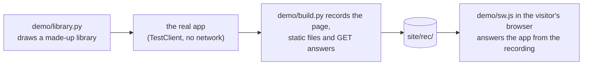

# For developers

[← Back to the README](../README.md)

[SPEC.md](../SPEC.md) is the full plan and [DECISIONS.md](../DECISIONS.md) explains the choices made.
Plugins: [PLUGINS.md](PLUGINS.md).

**The rule behind the code:** MangaVibe is a hub. The core stays small (scanning, the database, the
reader host, the plugin manager), and the parts people may want done differently are built-in
plugins doing a *job* (`app/contracts/`) that another plugin can take over. Built-in plugins import
only the public SDK (`app/plugins/sdk.py`, checked by `tests/contracts/test_sdk.py`), so they can't do
anything a plugin of the owner's can't. When adding a feature, ask first whether it belongs in a
plugin, and when it's a part someone could want to replace, make it a job with a contract in
docs/PLUGINS.md.

## Run on your PC

```bash
python -m venv .venv
.venv/Scripts/python -m pip install -r requirements-dev.txt
.venv/Scripts/python dev.py
```

Then open http://localhost:8090. `dev.py` creates a small fake library in `dev-library/`.
To use real manga: set `LIBRARY_PATHS=D:\Manga` before running it.

Working in a git worktree? Run `python preview.py` from it instead: it borrows the main checkout's
`.venv` and `dev-library`, gives each worktree its own port and database, opens the browser and
prints a LAN address for testing on a phone. Several worktrees can run at once.

## Tests

```bash
.venv/Scripts/python -m pytest
```

## Docker image

- `python build.py` builds `mangavibe:latest` locally, `--run` starts it with `docker-compose.yml`,
  `--save` writes `mangavibe.tar` (import it elsewhere with `docker load -i mangavibe.tar`).
- Releases: publish a GitHub release from `main`, e.g. `gh release create v1.4.0 --generate-notes`.
  GitHub Actions publishes the image to Docker Hub and ghcr.io (`.github/workflows/image.yml`) and
  builds the Android app (`.github/workflows/android.yml`), and running apps pick up the new code
  through auto-update. A pre-release (`--prerelease`) gets an image but is not offered to running
  apps. The old `releases` branch is no longer used.

## Layout

```
app/main.py             startup, routes
app/config.py           environment variables
app/models.py, db.py    SQLite tables, first start, migrations
app/users.py            who is asking (the owner without accounts), admins-only routes (`manage`)
app/passwords.py        password hashes and slowing down wrong guesses (libraries, accounts)
app/direction.py        how a series reads, paged or vertical (its own, a plugin's e.g. its library's, default)
app/scanner/            parser.py (file names), archives.py (reading), walker.py (scanning)
app/api/                series.py, books.py, system.py, filters.py (what a list shows, with the plugins' say)
app/plugins/            plugin system; web.py: plugins' own API, UI (page slots, scripts) and middleware
app/plugins/builtin/    plugins that come with the app, each doing a job another plugin can take over:
                        the views (cards, library_page, continue_page, series_page, nav, dialogs,
                        settings_pages), library_query, saved_searches, attention_lists, filename_parser,
                        title_matcher, book_labels, image_reader; plus AniList, MangaUpdates, optimize/,
                        libraries/ (Manga, Comics...; "shelves" in the code, passwords, LockGuard),
                        accounts/ (logins, AccountsGuard; off until switched on)
app/plugins/sdk.py      the public SDK: all a plugin (built in or not) may import from the app
app/contracts/          the jobs a plugin can do, and replace
app/updater.py          auto-update from the newest GitHub release
app/images.py           thumbnails, resized page cache
app/web/templates/      the page, as Jinja templates of Alpine markup (see "The page" below): page.html
                        includes shell/ (icons, banners, toasts), views/settings.html (the frame),
                        settings/ (Plugins, a plugin's page, Needs attention), sheets/, dialogs/ (the
                        folder picker); ui/macros.html holds the pieces used in several places.
                        The views are the built-in plugins' templates/views/ (cards, library_page,
                        continue_page, series_page, dialogs, nav, settings_pages), drawn with view()
app/web/static/css/     styles: main.css imports one file per feature (CSS layers)
app/web/static/js/      app.js (Alpine data), reader.js (plain-JS reader), common.js,
                        vendor/alpine.min.js
app/web/static/icons/   app icons; manifest.json next to them
android/                the Android app: MangaVibe in a fullscreen WebView (android/README.md)
examples/plugins/       example plugins
docker/entrypoint.sh    container start script
```

## The page

The app is one page, put together on the server from Jinja templates in `app/web/templates/` each time
it loads (`render_index()` in `app/plugins/web.py`), and run in the browser by Alpine.js (`app.js`).
Jinja only joins the files; everything that moves is Alpine. The two don't clash: Alpine never uses
`{{ }}`, so in a template `{{ … }}` and `` are always Jinja.

- **`page.html`** is the page. It includes the rest: `shell/` (icons, top bar, banners, toasts),
  `views/` (one file per view), `settings/` (one per Settings section), `sheets/` and `dialogs/`. Its
  views are drawn with `view()` from the templates of the plugin doing that view's job, so another plugin
  can replace any of them (docs/PLUGINS.md, "Replacing a view").
- **Markup used in more than one place is a macro** in `ui/macros.html` (`setting_rows(rows)`,
  `meta_progress()`): ``, then `{{ setting_rows("rows.reader") }}`.
- **Plugins' slots are `{{ slot("series-panels") }}`.** The name must be in `SLOTS`
  (`app/plugins/web.py`), or the page fails to render (and its test with it).
- **Autoescape is on** and a misspelt name is an error (`StrictUndefined`), so a template mistake shows up
  in the tests, not as an empty place in the page. Templates are compiled once and reloaded when a file
  changes, so an edit shows on the next page load.
- A new template has to be included somewhere: a test fails on a file nobody uses.

## Languages

Every text the page shows goes through `t()` (issue #263, `app/i18n.py`), so the app can be shown in other
languages. The translations are gettext files in `app/web/i18n/`: `messages.pot` (the template, made from
the code) and one `<lang>.po` per language (`bg`, `de`, `ja` so far). English is the code itself.

- **Templates**: `{{ t("Saved") }}`, `{{ t("See {url}", url=link) }}`, `{{ tn("{n} book", "{n} books", count) }}`.
  The page is drawn in the person's language on the server. Markup inside a sentence goes in a placeholder,
  marked safe: `{{ t("Path of {path}", path='<code x-text="l.path"></code>'|safe) }}` (the text itself is
  escaped). Plugins' own markup (`html`) isn't Jinja: there it's `x-text="t('…')"`, and `x-html="th('…', {…})"`
  for a sentence with markup.
- **Alpine expressions and scripts**: `t('Saved')`, `t('Now: {title}', { title })`, `tn(…)` (`common.js`);
  dates and numbers with `fmtDate`, `fmtDateTime`, `fmtTime`, `fmtNum`. Don't call a variable `t`
  (`x-for="t in tags"`): it would hide `t()` inside it; a test checks the templates.
- **Python** (e.g. a Settings page's label): `N_("Display")` marks it, `t()` translates it where it's shown:
  on the server while the page is drawn, or in the browser with `t(label)` when it comes from the API (job
  labels, plugin categories). `t()` of a text nobody marked is that text, so that's safe for any value.
- **Built-in plugins' scripts** call `MV.t(…)` (their name for `window.MangaVibe`); the extractor finds those too.
- Give `t()` the English text itself as one plain string ("…" or '…'): `python -m app.i18n` finds the texts
  by reading the code, so a variable, a `template ${string}` or `"a" + "b"` isn't found. Put changing parts
  in `{name}` placeholders instead of joining sentences, so a translator can move them.
- **After adding or changing texts, run `python -m app.i18n`**: it writes `messages.pot` and adds the new
  texts, empty, to each `.po` (and drops the ones the code no longer has). `tests/test_i18n.py` fails until
  you do, and when a translation loses a placeholder.
- **Translating**: fill in the `msgstr` lines of a `.po` file, by hand or with a gettext editor such as
  Poedit. An empty one is shown in English. **A new language**: `python -m app.i18n new fr`, then set its
  `Plural-Forms` header (Poedit and the gettext manual list them) and translate; it shows up in Settings →
  Display → Language by itself.

## New features and remote control

Everything a person can do should stay possible through
[Remote control](https://github.com/ivokolarov0/manga-vibe-mcp) (MCP, a plugin in its own repo), so
voice control doesn't fall behind. `screen_describe` / `screen_press` reach any control on the page by
itself; what needs care when adding a feature:

- **Give controls a name** a screen reader would read: text, `aria-label` or a `<label>`. An icon-only
  button without one shows up as a nameless "button" to an assistant (and to TalkBack).
- **Open things as dialogs or sheets** (`.modal`, `.sheet` with `x-dialog`): `screen_describe` then
  lists only what's in them, and Escape closes them.
- **New library filters, sorts or settings**: add them to `FILTERS`, `SORTS` or `SETTINGS` in
  manga-vibe-mcp's `mcp/tools.py` too. Here, `tests/test_plugin_api13.py` keeps a copy of those lists
  and fails when the page's change, to remind you; update both. (manga-vibe-mcp's own
  `tests/test_mcp.py` checks its lists against the page's too.)
- **Something faster to say than to click** (a whole flow, or a page that isn't on screen): a tool in
  manga-vibe-mcp's `tools.py`, or in a plugin `mcp_tools` / `MangaVibe.screenCommand()` (docs/PLUGINS.md,
  Plugin API 13).
- **The reader**: new buttons go into `MangaVibe.reader` (reader.js `state()` and friends) as well.

## The online demo

[The demo](https://ivokolarov0.github.io/manga-vibe/) is static files on GitHub Pages, with no
server behind it, made by the app itself so it never has to be kept in step by hand:



| File | What it does |
|---|---|
| `demo/library.py` | The series, covers and pages, drawn with Pillow (nobody's manga), and their details. |
| `demo/build.py` | Runs the app on that library, sets it up through its own API (details, posters, progress), and records every GET the page makes into `site/rec/` (`manifest.json`). The library's filters and sorts are recorded as ids per filter value (`list.json`); each plugin is switched once and back (`switches.json`). It stops if the builder's home folder or login name ends up in the output. |
| `demo/sw.js` | The service worker: answers from the recording; keeps plugin switches, settings and progress in memory for the visit; refuses deleting, editing, installing and uploading with a message. |
| `demo/index.html` | Installs the worker, then loads the app. |
| `demo/demo.js`, `demo.css` | The *Demo* badge on the app's page. |
| `demo/docs.html`, `demo/pages.py` | The [docs site](https://ivokolarov0.github.io/manga-vibe/docs/): every Markdown page in `pages.py` (the README, the install guides, the user docs, the [plugin reference](https://ivokolarov0.github.io/manga-vibe/plugins/) and the full guide) shown by `docs.html` with a sidebar of all pages and this page's sections. The Markdown is copied next to it, so the repo's file stays the only source. Add a new doc to `pages.py` to put it on the site; `tests/test_docs_site.py` checks the list and the links between docs. `tests/test_plugin_reference.py` runs every Python sample of the reference, so keep them working when the plugin API changes. |

Build and try it locally: `python demo/build.py` writes `demo/site/` (git-ignored). Serve its parent
under a path like Pages does (the worker reads its base from its scope), e.g. copy `demo/site` to
`srv/demo/`, run `python -m http.server -d srv` and open `http://localhost:8000/demo/`.

`.github/workflows/demo.yml` builds and publishes it (GitHub Pages, source: GitHub Actions) whenever a
release is published, so the demo shows the newest release; run it by hand to publish a branch or tag.
If a change makes the build fail (an API the build uses changed), fix `demo/build.py` with it.
