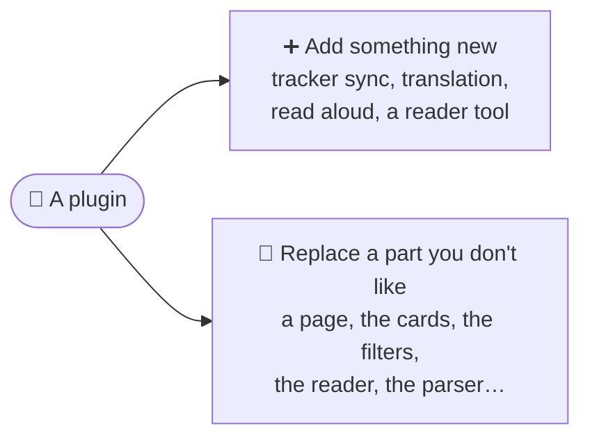
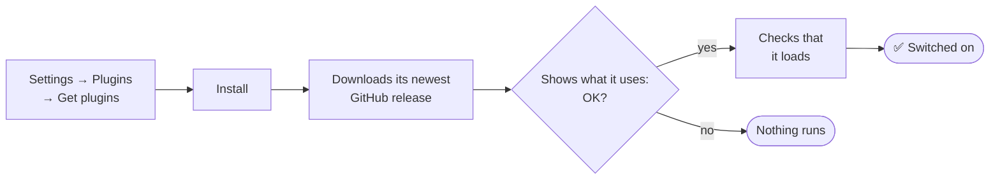
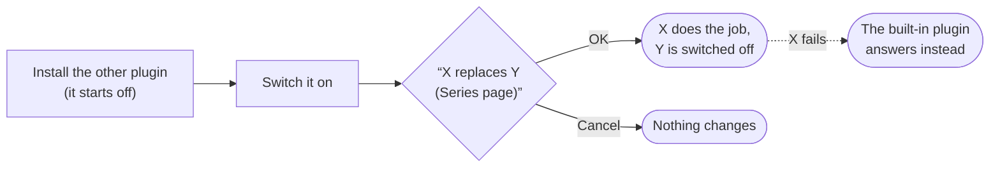

<h1 align="center">🧩 Plugins</h1>

  <a href="../README.md">← README</a> ·
  <a href="#available-plugins">Available</a> ·
  <a href="#install-a-plugin">Install</a> ·
  <a href="#find-a-plugin">Find</a> ·
  <a href="#replace-a-part-of-the-app">Replace a part</a> ·
  <a href="#update-a-plugin">Update</a> ·
  <a href="#write-your-own">Write your own</a>

> [!TIP]
> **Want to write one? Start with the [plugin reference](https://ivokolarov0.github.io/manga-vibe/plugins/)**
> ([also on GitHub](PLUGIN-REFERENCE.md)): every part of a plugin, each described in a few lines with a
> minimal code sample.

MangaVibe is meant to be customized as far as it can go, and plugins are how. A plugin is a single
`.py` file, or a folder, and it can do two things:

| | |
|---|---|
| ➕ **Add something new** | Tracker sync, translation, descriptions read aloud, a tool in the reader. |
| 🔁 **Replace a part of the app** | Most of MangaVibe is made of built-in plugins: the pages, the cards, the filters, the reader, the file name parser and more. Another plugin can do any of those parts instead. See [Replace a part of the app](#replace-a-part-of-the-app). |
| 🟰 **Nothing locked away** | The built-in plugins use the same plugin API as everyone else's, so a plugin of yours can do anything they do. If one is missing, [write it yourself](#write-your-own), or have an AI assistant write it for you. |

> [!IMPORTANT]
> **No paid plugins.** No part of MangaVibe may need a payment, plugins included: no paid plugins,
> subscriptions, paywalled features, or paid services (an AI model, say) that work through it. Money
> brings responsibilities: I'd have to keep the app compatible with paid plugins and stop making big
> changes so they don't break for paying customers, and I don't want that. This is a personal project.
> [Why, in full](qa.md#no-payments-no-paid-plugins).

---

## Available plugins

| Plugin | What it does |
|---|---|
| [MyAnimeList sync](https://github.com/ivokolarov0/manga-vibe-ext-mal-profile-sync) | Sends Reading / Completed to your MyAnimeList list as you read, and pulls them back with **Sync all**. Its README shows how to connect your account step by step. |
| [Manga Translate](https://github.com/ivokolarov0/manga-vibe-ext-translate) | Shows English over the speech bubbles of Japanese manga while you read. Small AI models on your own computer find, read and translate the text: free, private, nothing is sent online. Needs a computer with a graphics card on your network (or the same one). |
| [Manga Accessibility](https://github.com/ivokolarov0/manga-vibe-ext-accessibility) | For readers who are blind or have low vision: describes every panel, who says what and the sound effects, and MangaVibe reads it aloud. Needs only Ollama with a model that can see pictures (e.g. gemma4), on a computer on your network. |
| [Official chapters](https://github.com/ivokolarov0/manga-vibe-ext-official-chapters) | Finds how many chapters a series really has, since AniList's count is often wrong or behind. Checks the series' official Japanese sites and MangaUpdates, and searches the web (free, no account) when they have no number. Every source is listed with its number under **Details**, so you can compare them. Optional: Ollama (e.g. gemma4) to read pages and search results it has no parser for. |
| [Remote control (MCP)](https://github.com/ivokolarov0/manga-vibe-mcp) | Lets an assistant (Claude, or any app that speaks MCP) use MangaVibe for you: search, read, turn pages, change settings and press any button on an open screen. The base for voice control. Each person makes their own keys; a key acts as them. A folder plugin: copy its `mcp` folder into `plugins`. |
| [Light novel reader](https://github.com/ivokolarov0/manga-vibe-light-novel) | Reads light novels (EPUBs that are text, not pictures) as text: the book's contents, font, size, spacing, four colour themes, and pages or scrolling. Picks up where you left off, inside the chapter too, and progress and tracker sync work as for manga. Without it, these books are listed under **Needs attention → Not supported**. A folder plugin: copy its `light_novel` folder into `plugins`. |

> [!WARNING]
> **Only install plugins you trust.** A plugin is code that runs inside MangaVibe with full access
> to its data, including the logins other plugins save. Install plugins from this list or ones whose
> code you've read.

---

## Optimize (built in)

Makes your books smaller by converting their PNG, JPEG, BMP and TIFF pages to **JPEG XL** (or AVIF
or WebP). Often half the size or less, and PNG pages far more. It's off until you switch it on in
**Settings → Plugins**.

- **One series:** **Optimize this series** on its page. Each book then shows what it saved (e.g. *−53%*).
- **Everything:** **Settings → Plugins → Optimize → Optimize all series**. It works through the
  library in the background (it carries on after a restart), and the line under the plugin shows
  how far it is and how much it has saved. **Stop** stops after the page it's on.
- **Settings:** the format (JPEG XL by default) and the quality (*Normal* looks like the original
  when reading; *Small* saves more; *High* saves less).

> [!IMPORTANT]
> **It replaces your files**, and the original pages can't be brought back. The conversion is lossy:
> pages look the same when reading, but aren't identical to the originals. Keep a backup if you want
> those.

What it does to keep your books safe:

- A book is written to a new hidden file next to the old one, and replaces it only once every page
  opened, the page count and order are the same, and the old file didn't change meanwhile.
- A page that wouldn't get at least 10% smaller stays as it is. That's why some pages of a book may
  stay `.jpg`: JPEGs saved at very high quality (common in official releases) barely shrink at
  *High*; *Normal* converts most of them. Pages already in WebP, AVIF or JPEG XL, EPUBs, PDFs and
  archives inside archives are left alone.
- `.cbr` and `.cb7` books become `.cbz` (RAR and 7z can't be written). Reading progress, your manual
  chapter numbers and other plugins' data (e.g. translations) are kept.
- It needs the manga folder mounted read-write (not `:ro`) and room on the drive for one book's copy.

MangaVibe shows JPEG XL and AVIF in every browser. **Other comic apps may not open them**: pick WebP
if you also read the files elsewhere.

---

## AniList recommendations (built in)

**If you liked this** at the end of a series page: the series AniList's readers recommend, best rated
first, each with its cover. A series you already have shows *In your library* and opens its page here;
the others open on AniList. Only series matched on AniList get them; the others show nothing extra.

- **Covers:** *Saved on this server* (the default) downloads each cover once and keeps it, so they show
  offline and your browser only talks to MangaVibe. *Loaded from AniList* uses no disk space, but your
  browser asks AniList for every cover.
- **How many:** up to 5, 10 (the default), 15 or 25.
- **Ask AniList again after:** a day, a week (the default) or a month. Until then a series shows what it
  got last time, so opening a series page doesn't ask AniList each time.
- **Forget saved recommendations and covers** on its page in **Settings → Plugins** clears them all; the
  line under the plugin says how many series and covers are saved, and how much space they take.

Adult series are left out unless **Settings → Metadata → Include adult titles** is on. Switch the plugin
off in **Settings → Plugins** and the series page shows nothing extra.

---

## Random manga (built in)

For when you can't decide what to read next. **Random** on the library page (next to Filter and Sort; on
phones just its shuffle icon), or in the **Sidebar**'s column on wide screens, opens a series picked at random from the
library shown: the library you picked, never a locked one. Its page then has **Pick another**, to pick
again without going back. A series picked lately comes up again only once the others are used up.

- **Exclude read manga** (on by default): series whose reading status is *Completed* are left out.
- **Exclude dropped manga** (on by default): series whose reading status is *Dropped* are left out.

The reading status is the one the series page shows: the one you picked, or else worked out from what
you've read. When the settings leave nothing to pick, it says so. Each person picks by their own
reading status. Switch the plugin off in **Settings → Plugins** and its buttons go away.

---

## Install a plugin

**Settings → Plugins → Get plugins** lists the plugins you can install with one button: MangaVibe's
own (the ones above) and those of any other source you added. **Install** downloads the plugin's
newest release from its GitHub repo into the `plugins` folder of your data folder, shows what it
uses (its permissions) and asks you before any of it runs, checks that it loads, and switches it on
(except plugins that start off, like Remote control: switch those on yourself). Plugins you have
already are marked *Installed*. Search it, or pick a category above the list. The tab shows how
many plugins you don't have yet.

### Plugin sources

A source is a list of plugins someone publishes (a `plugins.json` file, see
[PLUGINS.md](PLUGINS.md#publish-your-plugins-in-a-source)). Under **Settings → Plugins → Sources &
setup**, type its GitHub
repo (`owner/name`, or its github.com address) or the address of the file, and press **Add source**.
Its plugins then show under **Get plugins**, tagged with the source's name. **Remove** stops listing
it; plugins you installed from it stay. **Refresh** asks every source again (they're kept for ten
minutes otherwise). MangaVibe's own source is always there.

> [!WARNING]
> Add only sources you trust: whoever runs a source decides which code **Install** downloads.

### By hand

1. Download the plugin's `.py` file (on GitHub: open the file → **Download raw file**). A folder
   plugin (e.g. Remote control's `mcp`): download the repo (**Code → Download ZIP**), unpack it and
   take that folder.
2. Put it in the `plugins` folder of your data folder: `docker/mangavibe/plugins` on a Synology, or
   `plugins` inside the folder you mounted as `/data` (create it if it isn't there).
3. In MangaVibe: **Settings → Plugins → Sources & setup → Reload plugins**. The plugin appears under
   **Installed**.
   Tap it to open its page: what it does, what it uses, its settings, buttons and updates.

---

## Find a plugin

**Settings → Plugins** has three tabs: **Installed** (the plugins you have, built in ones included),
**Get plugins** (the ones you can install) and **Sources & setup** (plugin sources, **Reload
plugins** and the GitHub token). A dot on **Installed** means an update is waiting or a plugin
failed to load.

**Installed** groups plugins by what they change:

- **Categories** on the left (a row of chips on a phone): *Metadata*, *Reader*, *Library*,
  *System*, *Appearance* and *Other*, each with how many plugins it has. A plugin that changes more
  than one area is listed under its main one and tagged with the others.
- **Source:** *Installed* (the ones you added) or *Built in* (they come with MangaVibe). Installed
  plugins are listed first; the built-in ones are folded away under **Built in**, since they're
  rarely changed. Tap it to open them.
- **Search** by name or description, and show only plugins that are **On**, **Off**, have an
  **Update**, or **Errors** (plugins that failed to load, with the reason).
- Updates and plugins that failed to load are also counted at the top, so they aren't missed.

Each row is kept short (name, a line of description, its status); tap it for the rest: what it
does, its settings, buttons and updates.

What you picked (tab, category, source, filter) is remembered in this browser.

In the reader, everything a plugin adds is under **Plugins** at the bottom of the reading options:
one row per plugin, which opens a panel with its switches and buttons.

---

## Replace a part of the app

Each part of MangaVibe that can be replaced is a **job**, and a plugin's page says which jobs it does
(*Does: Series page*) and which ones it needs another plugin to do (*Needs: …*).

These are the parts a plugin can do today, each done by a built-in plugin until you pick another:

| Part | What it is |
|---|---|
| Library page, Continue reading page, Series page | the pages themselves |
| Series cards | how a series looks in the grid, the list and Continue reading |
| Navigation | the built-in **Sidebar**, the default (Home, Library, Continue, your libraries and Settings on the left, the search box at the top; a floating bar on phones), or the built-in **Top bar** (the search box and Settings at the top, Library and Continue in a bar) |
| Edit dialog, Fix match dialog | editing a series' details and poster; picking the right metadata |
| Settings: Library folders, Display, Reader, Metadata, Updates | Settings' pages (these can also just be switched off) |
| Library filters and sorting | what the library can be filtered and sorted by |
| Image reader | how pages are drawn while reading: paged or vertical, zoom, swipes, the fit |
| File name parser | the volume and chapter read from a file's name |
| Metadata matcher | which AniList / MangaUpdates result a folder is |
| Book labels | what a book is called (*Vol 3*, *Ch 12-14*); switched off, books show their file names |
| Needs attention lists, Saved searches | shared: every plugin doing one adds to it |

More parts become replaceable over time.

**To swap one:** install the other plugin (it starts off, so nothing changes yet), then switch it on in
**Settings → Plugins**. MangaVibe tells you which plugin it replaces (*X replaces Y (Series page)*) and
switches that one off when you confirm. To go back, switch the built-in one on again.

**Plugins that do the same part are grouped.** Once you have two or more plugins for one part (the Top bar
and the Sidebar, say), Settings → Plugins lists them as one row named after the part (*Navigation · Pick
one*), which says which one is in use and how many there are. Open it to see them, each with a **Use**
button instead of a switch: using one switches the other off, without asking (it still asks if the plugin
takes over other parts too). A part the app can do without has a **None** choice too.

- **Required.** Some parts the app can't do without (the reader, the parser, the pages…). The plugin
  doing one is marked **Required** and its switch can't be used: switch on another plugin for that
  part first, and the old one is switched off for you.
- **A plugin that can't run doesn't.** If it needs a part no switched-on plugin does, or was made for
  another version of MangaVibe, its page says why (*Not running: …*). It starts once the reason is gone.
- **If a replacement fails**, the built-in plugin for that part steps in, so the app keeps working.
- **Safe mode:** if a plugin breaks the page so you can't reach Settings, open MangaVibe with `/?safe=1`
  at the end of its address (e.g. `http://192.168.1.5:8080/?safe=1`). The page loads with only the
  built-in plugins; switch the broken one off in **Settings → Plugins**, then leave safe mode from
  the bar at the top.
- **Changing the parser** reads every book's volume and chapter again on the next library scan. Only
  the numbers MangaVibe worked out change: your progress and the numbers you set by hand stay.

---

## Update a plugin

Plugins that publish releases on GitHub have an **Updates** part on their page (**Settings →
Plugins**, then the plugin). The list shows *Update X* next to a plugin with a new
version:

- MangaVibe checks once a day and shows *Version X is available*. **Check for updates** looks right away.
- Press **Update to X** to install it, or **Skip this version** if you don't want it. A skipped
  version isn't offered again, but a newer one is. **Show it again** brings it back.

Plugins never update by themselves. The new version is checked before it replaces the old one, and
your plugin settings are kept. For other plugins, replace the file (or folder) and press **Reload
plugins**.

### Go back to an earlier version

If a new version of a plugin has a problem, open its page and look under **Earlier versions**:

- **Go back to X** puts back the copy MangaVibe kept when it updated the plugin (in
  `plugins/.backup/`). Nothing is downloaded.
- **Other versions…** lists the plugin's releases on GitHub. Pick one and press **Install**.

The version you go back to is checked the same way as an update: it has to load, and if it asks
for permissions the installed version doesn't have, you're asked first. The version you left
isn't offered again until a newer one is out.

A plugin whose GitHub repo is private needs a token: create a
[fine-grained token](https://github.com/settings/personal-access-tokens/new) with access to that
repo and **Contents: Read-only**, then paste it under **Settings → Plugins → Sources & setup →
GitHub token for private plugins**. It's only sent to GitHub, and isn't shown again.

---

## Switch off or remove a plugin

Switch a plugin off with its toggle in **Settings → Plugins** (a plugin marked **Required** can only
be replaced, see above). To remove it, delete its file and press **Reload plugins** (under **Sources &
setup**).

---

## Write your own

This is what MangaVibe is built for: if something works in a way you don't like, change it with a
plugin instead of waiting for the app. Start small (a theme, an extra field on the series page, a
button), or take over a whole part, like the series page or the reader, starting from the built-in
plugin in `app/plugins/builtin/`. Plugins are Python, with HTML, CSS and JavaScript for what they add
to the page, and an AI assistant can write one for you from a description.

Start with the [plugin reference](https://ivokolarov0.github.io/manga-vibe/plugins/) (also
[here](PLUGIN-REFERENCE.md)): every part of a plugin with a minimal sample. See [PLUGINS.md](PLUGINS.md)
for how plugins work in depth, each part's contract (what a replacement must do), and the examples in
[examples/plugins](../examples/plugins).
For only the looks, `custom.css` in the data folder is enough.
